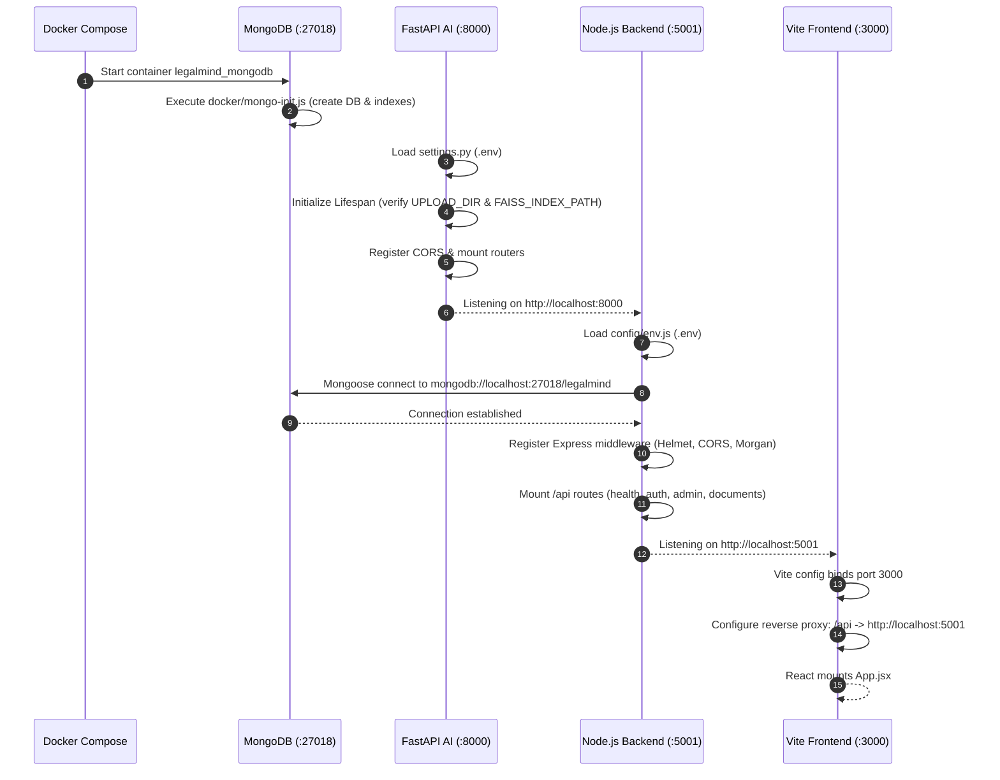
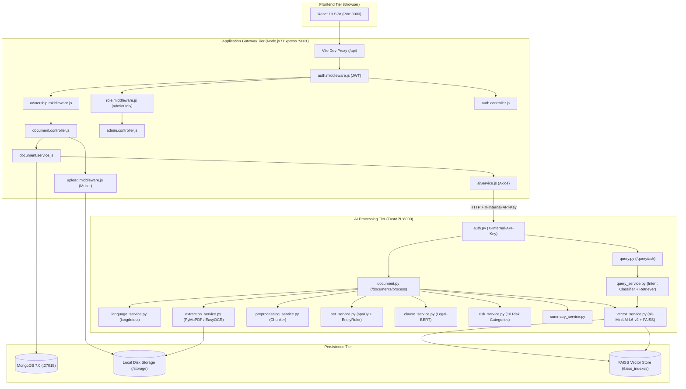

# LegalMind AI — Comprehensive Project Structure Report

**Date of Audit:** October 10, 2026  
**Auditor:** Senior Software Architect & Codebase Documentation Specialist  
**Workspace Root:** `/Users/trush/Desktop/LegalMindAI`  
**Current Implementation Milestone:** Part 11 Complete (RAG Retrieval + Query Intent Classification Operational; Part 12 LangGraph + Gemini Generation Pending)

---

## 1. Project Overview

**LegalMind AI** is an agentic legal document intelligence and risk analysis platform architected around dynamic, user-uploaded legal documents (such as employment contracts, lease agreements, NDAs, and corporate policies in PDF, DOCX, and TXT formats). 

The platform implements a decoupled, **two-tier backend architecture with a single frontend client interface**:
1. **Frontend Client (`frontend/`)**: Built with React 19 and Vite 8, featuring an administrative and diagnostic dashboard that communicates strictly through the Node.js API gateway.
2. **Main Application Backend (`backend/node-server/`)**: Built on Node.js and Express 4, providing JWT authentication, role-based authorization (`normal_user` vs. `admin`), MongoDB document and metadata persistence via Mongoose 8, document file management via Multer, and internal AI client dispatching.
3. **AI / Document Processing Service (`ai-service/`)**: Built on Python 3 and FastAPI (with Uvicorn), implementing a modular multi-stage NLP and retrieval pipeline:
   - **Language Detection & Normalization**: English, Hindi (Devanagari script), and Gujarati detection via `langdetect` and Unicode script analysis.
   - **Text Extraction & Hybrid OCR**: Native digital extraction via PyMuPDF (`fitz`), scanned PDF OCR fallback via EasyOCR, and native `.docx`/`.txt` readers.
   - **Text Preprocessing & Overlap Chunking**: Legal text normalization, clean punctuation, and word-based windowing (Target: 400 words, Bounds: 30–600 words, Overlap: 50 words).
   - **Named Entity Recognition (NER)**: spaCy (`en_core_web_sm`) augmented with a custom legal `EntityRuler` capturing parties, amounts, and dates.
   - **Clause Extraction & Classification**: Zero-shot anchor-based semantic cosine scoring via Legal-BERT (`nlpaueb/legal-bert-base-uncased`) cross-validated with rule-based regex patterns across 14 legal clause types.
   - **Risk Analysis Engine**: A 10-category deterministic legal risk evaluation engine calculating severity-weighted risk scores (0–100) with diminishing return penalties and formal statutory citations (e.g., Section 27 Indian Contract Act).
   - **Summarization & Dense Embedding**: Extracted structure synthesis and 384-dimensional dense vector embeddings generated via `sentence-transformers/all-MiniLM-L6-v2`.
   - **Vector Database (FAISS)**: Isolated, document-specific FAISS CPU vector indexes with adjacent metadata JSON mappings.
   - **Query Intent Classification & Semantic RAG Retrieval**: Intent routing across 5 categories (`risk`, `clause`, `summary`, `date`, `general`) and FAISS dense vector retrieval with page/section citations.

---

## 2. Workspace Root and Directory Tree

### Complete Workspace Tree
*(Generated from direct scan of actual workspace files; vendor directories `node_modules/` and `venv/` are listed by existence and summarized in the exclusion notice).*

```text
LegalMindAI/
├── .env                                  # Local environment configuration (Secrets redacted)
├── .env.example                          # Canonical environment configuration template
├── .gitignore                            # Git version control ignore rules
├── README.md                             # Architectural specification & milestone roadmap
├── docker-compose.yml                    # Multi-container orchestration (MongoDB + Mongo Express)
│
├── ai-service/                           # Python / FastAPI AI Document Processing Microservice
│   ├── requirements.txt                  # Python runtime package dependencies
│   ├── venv/                             # [Excluded from detailed inventory] Python virtual environment
│   └── app/                              # Core FastAPI application package
│       ├── __init__.py                   # Package initializer
│       ├── main.py                       # FastAPI application entry point, CORS & router aggregation
│       ├── config/                       # Service configuration layer
│       │   ├── __init__.py               # Config package initializer
│       │   └── settings.py               # Pydantic BaseSettings loading root .env
│       ├── middleware/                   # HTTP middleware & security interceptors
│       │   ├── __init__.py               # Middleware package initializer
│       │   └── auth.py                   # Internal API Key verification dependency & middleware
│       ├── routers/                      # FastAPI endpoint controllers
│       │   ├── __init__.py               # Routers package initializer
│       │   ├── health.py                 # Health check, status & multi-service chain-test endpoints
│       │   ├── document.py               # Full document processing pipeline orchestration (/documents/process)
│       │   ├── language.py               # Standalone language detection & text prep endpoints
│       │   ├── extraction.py             # Standalone OCR & digital text extraction endpoints
│       │   ├── preprocessing.py          # Standalone text cleaning & chunking endpoints
│       │   ├── analysis.py               # Standalone NER & Legal-BERT clause classification endpoints
│       │   ├── risk.py                   # Standalone risk analysis engine endpoints
│       │   ├── vector.py                 # FAISS vector indexing & semantic search endpoints
│       │   └── query.py                  # Query intent analysis & FAISS RAG retrieval endpoints
│       ├── services/                     # Business logic, ML models & NLP pipelines
│       │   ├── __init__.py               # Services package initializer
│       │   ├── language_service.py       # Langdetect + Devanagari/Gujarati script detectors
│       │   ├── extraction_service.py     # PyMuPDF + EasyOCR hybrid extraction engine
│       │   ├── preprocessing_service.py  # Text normalizer & sliding window chunker
│       │   ├── ner_service.py            # spaCy + custom Indian legal EntityRuler
│       │   ├── clause_service.py         # Legal-BERT anchor similarity classifier
│       │   ├── risk_service.py           # 10-category legal risk rule evaluator & scoring engine
│       │   ├── summary_service.py        # Structured legal summary generator
│       │   ├── vector_service.py         # SentenceTransformer (all-MiniLM-L6-v2) & FAISS manager
│       │   └── query_service.py          # Intent regex classifier & FAISS similarity retriever
│       └── utils/                        # Shared utility package
│           └── __init__.py               # Utility package initializer
│
├── backend/                              # Node.js / Express Application Gateway & Persistence Backend
│   └── node-server/                      # Express backend project root
│       ├── package.json                  # Node.js project manifest & npm scripts
│       ├── package-lock.json             # Pinned dependency lockfile
│       ├── node_modules/                 # [Excluded from detailed inventory] Installed npm packages
│       └── src/                          # Express source code
│           ├── server.js                 # HTTP listener & database connection bootstrap
│           ├── app.js                    # Express app configuration, security middleware & routing
│           ├── config/                   # Backend configuration modules
│           │   ├── env.js                # Environment variable reader with defaults
│           │   └── database.js           # Mongoose MongoDB connection manager
│           ├── controllers/              # Express request/response handlers
│           │   ├── auth.controller.js     # User registration, login, profile & password handlers
│           │   ├── admin.controller.js    # System-wide user & document management, stats
│           │   └── document.controller.js # Document upload, listing, status & RAG chat handler
│           ├── middleware/               # Express request pipeline middleware
│           │   ├── auth.middleware.js    # JWT bearer verification & user hydration
│           │   ├── role.middleware.js    # Role-based authorization gatekeeper (adminOnly)
│           │   ├── ownership.middleware.js # Document ownership validation guard
│           │   ├── upload.middleware.js   # Multer disk storage, MIME filtering & size limits
│           │   ├── requestLogger.js      # Structured HTTP request logger
│           │   ├── notFound.js           # 404 Not Found error handler
│           │   └── errorHandler.js       # Centralized JSON error formatting middleware
│           ├── models/                   # Mongoose data models & schemas
│           │   ├── index.js              # Central model barrel export
│           │   ├── User.model.js         # User identity, hashed passwords & roles
│           │   ├── Document.model.js     # Core document lifecycle, status & file references
│           │   ├── DocumentMetadata.model.js # Extraction metrics, language & OCR stats
│           │   ├── AnalysisResult.model.js   # NER entities, classified clauses & summaries
│           │   ├── RiskFinding.model.js  # Flagged risky clauses, severity & recommendations
│           │   ├── ChatHistory.model.js  # Q&A conversation history & citations
│           │   └── Report.model.js       # Generated PDF report tracking schema
│           ├── routes/                   # Express router definitions
│           │   ├── health.routes.js      # Express health, AI service ping & full chain test
│           │   ├── auth.routes.js        # Authentication endpoints (/api/auth)
│           │   ├── admin.routes.js       # Administrative management endpoints (/api/admin)
│           │   └── document.routes.js    # Document management & chat endpoints (/api/documents)
│           ├── services/                 # Express business logic & external integrations
│           │   ├── aiService.js          # Axios client for FastAPI communication
│           │   └── document.service.js   # Document orchestration & pipeline synchronization
│           └── utils/                    # Shared helper utilities & integration test suites
│               ├── jwt.utils.js          # JWT signing, verification & header parsing
│               ├── authTest.js           # Test suite: Authentication & role enforcement
│               ├── modelTest.js          # Test suite: Mongoose schemas & MongoDB writes
│               ├── documentTest.js       # Test suite: Multer upload & metadata persistence
│               ├── languageTest.js       # Test suite: English/Hindi/Gujarati detection
│               ├── extractionTest.js     # Test suite: Digital PDF, scanned OCR, DOCX & TXT
│               ├── preprocessingTest.js  # Test suite: Text cleaning & sliding window chunking
│               ├── analysisTest.js       # Test suite: NER extraction & Legal-BERT classification
│               ├── analysisDetailTest.js # Test suite: Deep validation of entity & clause scoring
│               ├── riskTest.js           # Test suite: Risk engine rules, scoring & citations
│               ├── vectorTest.js         # Test suite: Embeddings generation & FAISS search
│               └── queryTest.js          # Test suite: Part 11 RAG query analyzer & retrieval
│
├── docker/                               # Containerization infrastructure scripts
│   └── mongo-init.js                     # MongoDB replica/auth database initialization script
│
├── docs/                                 # Project documentation repository
│   └── .gitkeep                          # Git retention placeholder
│
├── reports/                              # Generated analysis report target directory
│   └── .gitkeep                          # Git retention placeholder
│
├── faiss_indexes/                        # Runtime FAISS vector indexes (Data Artifacts)
│   ├── .gitkeep                          # Git retention placeholder
│   ├── 6ac9ce59311b06531198ba16.index   # FAISS binary vector index for document 6ac9ce59...
│   ├── 6ac9ce59311b06531198ba16_meta.json# Chunk text and citation metadata for 6ac9ce59...
│   ├── 6ac9d1fb7005c03f906b5803.index   # FAISS binary vector index for document 6ac9d1fb...
│   ├── 6ac9d1fb7005c03f906b5803_meta.json# Chunk text and citation metadata for 6ac9d1fb...
│   ├── 6ac9d2cac1d534c0f06e9d9e.index   # FAISS binary vector index for document 6ac9d2ca...
│   ├── 6ac9d2cac1d534c0f06e9d9e_meta.json# Chunk text and citation metadata for 6ac9d2ca...
│   ├── test-doc-faiss-001.index          # Test FAISS binary index
│   └── test-doc-faiss-001_meta.json      # Test FAISS metadata mapping
│
├── storage/                              # Uploaded document filesystem storage (Data Artifacts)
│   ├── .gitkeep                          # Git retention placeholder
│   ├── debug-user/                       # Debug user uploaded files
│   └── [user_id]/                        # User-segregated document storage folders (34 files)
│
└── frontend/                             # React / Vite Frontend User Interface
    ├── .gitignore                        # Frontend-specific Git ignore rules
    ├── README.md                         # Vite + React template documentation
    ├── package.json                      # Frontend package dependencies & build scripts
    ├── package-lock.json                 # Frontend pinned lockfile
    ├── vite.config.js                    # Vite dev server & /api proxy configuration
    ├── eslint.config.js                  # ESLint flat config rules
    ├── index.html                        # Single Page Application HTML root
    ├── node_modules/                     # [Excluded from detailed inventory] Frontend npm packages
    ├── public/                           # Static assets served as-is
    │   ├── favicon.svg                   # Application favicon
    │   └── icons.svg                     # Vector SVG icon bundle
    └── src/                              # Frontend source code
        ├── main.jsx                      # React application bootstrap & DOM mounting
        └── App.jsx                       # Full-system diagnostic monitor & chain-test UI
```

### Documented Directory Exclusions
The following high-volume, third-party, or generated directories were detected and deliberately excluded from individual line-by-line source audits:
1. `backend/node-server/node_modules/` (150 directories): Installed Node.js package dependencies managed via npm.
2. `frontend/node_modules/` (173 directories): Installed frontend dependencies managed via npm.
3. `ai-service/venv/` (Python virtual environment): Third-party C-extensions, PyTorch wheels, and site-packages.
4. `*/__pycache__/`: Python bytecode cache files.
5. `storage/[user_id]/*`: Runtime document payload text files uploaded during integration test runs.
6. `faiss_indexes/*.index`: Binary FAISS serialization vectors generated at runtime.

---

## 3. Complete File Inventory

The workspace contains **89 tracked project source and configuration files** across all modules.

| No. | Relative Path | File Name | File Type | Purpose | Key Components | Dependencies |
|---|---|---|---|---|---|---|
| 1 | `.env` | `.env` | Config / Env | Local environment variable definitions | Secret keys, ports, URIs | N/A |
| 2 | `.env.example` | `.env.example` | Config / Template | Public template for environment configuration | Documented config keys | N/A |
| 3 | `.gitignore` | `.gitignore` | Config / Git | Defines files ignored by Git version control | Ignore rules for node, python, storage | N/A |
| 4 | `README.md` | `README.md` | Documentation | Architectural specification and milestone guide | System design, workflows, rules | N/A |
| 5 | `docker-compose.yml` | `docker-compose.yml` | Infrastructure | Container orchestration for MongoDB and Mongo Express | `mongodb`, `mongo-express` services | Docker |
| 6 | `docker/mongo-init.js` | `mongo-init.js` | Database Script | Database initialization and index creation for MongoDB | Collection creation (`users`, `documents`, etc.) | MongoDB Engine |
| 7 | `docs/.gitkeep` | `.gitkeep` | Git Retention | Preserves empty `docs` directory in Git | Empty | N/A |
| 8 | `reports/.gitkeep` | `.gitkeep` | Git Retention | Preserves empty `reports` directory in Git | Empty | N/A |
| 9 | `ai-service/requirements.txt` | `requirements.txt` | Dependency Manifest | Declares Python microservice package requirements | FastAPI, PyMuPDF, EasyOCR, spaCy, Transformers, FAISS | pip |
| 10 | `ai-service/app/__init__.py` | `__init__.py` | Python Package | Marks `app` directory as Python package | Empty | Python Runtime |
| 11 | `ai-service/app/main.py` | `main.py` | Source / Entry Point | FastAPI entry point, lifespan, CORS, router mounts | `app`, `lifespan`, router inclusion | FastAPI, Uvicorn, settings, routers |
| 12 | `ai-service/app/config/__init__.py` | `__init__.py` | Python Package | Marks `config` as Python package | Empty | Python Runtime |
| 13 | `ai-service/app/config/settings.py` | `settings.py` | Configuration | Pydantic BaseSettings loading system env vars | `Settings` class, paths, ports, API keys | `pydantic-settings`, `pathlib` |
| 14 | `ai-service/app/middleware/__init__.py` | `__init__.py` | Python Package | Marks `middleware` as Python package | Empty | Python Runtime |
| 15 | `ai-service/app/middleware/auth.py` | `auth.py` | Security / Middleware | Enforces internal shared API key on FastAPI routes | `require_internal_api_key`, `verify_internal_api_key` | FastAPI `Depends`, settings |
| 16 | `ai-service/app/routers/__init__.py` | `__init__.py` | Python Package | Marks `routers` as Python package | Empty | Python Runtime |
| 17 | `ai-service/app/routers/health.py` | `health.py` | Router / API | Health status, dependency inspection & chain test | `/health`, `/health/chain-test`, `/health/status` | `APIRouter`, settings |
| 18 | `ai-service/app/routers/document.py` | `document.py` | Router / API | Full pipeline orchestration endpoint for documents | `process_document`, `document_service_health` | All AI services, settings, auth |
| 19 | `ai-service/app/routers/language.py` | `language.py` | Router / API | Dedicated language detection and normalization API | `/language/detect`, `/language/supported` | `language_service`, auth |
| 20 | `ai-service/app/routers/extraction.py` | `extraction.py` | Router / API | Dedicated OCR and digital text extraction API | `/extraction/extract` | `extraction_service`, auth |
| 21 | `ai-service/app/routers/preprocessing.py` | `preprocessing.py` | Router / API | Dedicated text cleaning and chunking API | `/preprocessing/process`, `/preprocessing/clean` | `preprocessing_service`, auth |
| 22 | `ai-service/app/routers/analysis.py` | `analysis.py` | Router / API | Dedicated NER and clause classification API | `/analysis/ner`, `/analysis/clauses`, `/analysis/full` | `ner_service`, `clause_service` |
| 23 | `ai-service/app/routers/risk.py` | `risk.py` | Router / API | Dedicated legal risk assessment engine API | `/risk/analyze`, `/risk/categories`, `/risk/health` | `risk_service`, auth |
| 24 | `ai-service/app/routers/vector.py` | `vector.py` | Router / API | FAISS index building and semantic search API | `/vector/index`, `/vector/search`, `/vector/summary` | `vector_service`, `summary_service` |
| 25 | `ai-service/app/routers/query.py` | `query.py` | Router / API | Query intent analysis & FAISS RAG retrieval API | `/query/analyze`, `/query/retrieve`, `/query/ask` | `query_service`, auth |
| 26 | `ai-service/app/services/__init__.py` | `__init__.py` | Python Package | Marks `services` as Python package | Empty | Python Runtime |
| 27 | `ai-service/app/services/clause_service.py` | `clause_service.py` | Service / ML | Legal-BERT semantic anchor similarity classifier | `extract_clauses`, `_init_legal_bert` | `transformers`, `torch`, `numpy` |
| 28 | `ai-service/app/services/extraction_service.py` | `extraction_service.py` | Service / OCR | Hybrid digital (PyMuPDF) and OCR (EasyOCR) extractor | `extract_text`, `TextChunk`, `ExtractionResult` | `fitz`, `easyocr`, `docx` |
| 29 | `ai-service/app/services/language_service.py` | `language_service.py` | Service / NLP | Language detector for English, Hindi, and Gujarati | `detect_language`, `prepare_text_for_pipeline` | `langdetect`, `ftfy`, `unicodedata` |
| 30 | `ai-service/app/services/ner_service.py` | `ner_service.py` | Service / NLP | spaCy legal NER with custom Indian Legal EntityRuler | `extract_entities`, `_build_entity_ruler_patterns` | `spacy`, regex |
| 31 | `ai-service/app/services/preprocessing_service.py` | `preprocessing_service.py` | Service / NLP | Text normalizer and sliding-window chunker with overlap | `preprocess_chunks`, `clean_text`, `split_large_chunk` | `ftfy`, regex, `TextChunk` |
| 32 | `ai-service/app/services/query_service.py` | `query_service.py` | Service / NLP | Query intent analyzer & FAISS similarity retriever | `analyze_query`, `retrieve_for_query` | `vector_service`, regex |
| 33 | `ai-service/app/services/risk_service.py` | `risk_service.py` | Service / Rules | 10-category legal risk analysis and scoring engine | `analyze_document_risk`, `LEGAL_DISCLAIMER` | `re`, `dataclasses` |
| 34 | `ai-service/app/services/summary_service.py` | `summary_service.py` | Service / Logic | Synthesizes structured document summaries & key points | `generate_document_summary`, `DocumentSummary` | `dataclasses` |
| 35 | `ai-service/app/services/vector_service.py` | `vector_service.py` | Service / Vector | Dense embeddings (`all-MiniLM-L6-v2`) and FAISS manager | `create_and_save_faiss_index`, `search_faiss_index` | `sentence_transformers`, `faiss` |
| 36 | `ai-service/app/utils/__init__.py` | `__init__.py` | Python Package | Utility package placeholder | Empty | Python Runtime |
| 37 | `backend/node-server/package.json` | `package.json` | Dependency Manifest | Node.js backend package dependencies and scripts | Express, Mongoose, Multer, Axios, JWT, Bcrypt | npm |
| 38 | `backend/node-server/package-lock.json` | `package-lock.json` | Dependency Lock | Exact dependency version tree for backend | Lock definitions | npm |
| 39 | `backend/node-server/src/server.js` | `server.js` | Source / Entry Point | Backend server bootstrap, MongoDB connection, listen | `startServer` | `app.js`, `database.js`, `env.js` |
| 40 | `backend/node-server/src/app.js` | `app.js` | Source / Framework | Express application configuration & routing pipeline | `app`, middleware, route mounts | `express`, `cors`, `helmet`, routers |
| 41 | `backend/node-server/src/config/env.js` | `env.js` | Configuration | Loads root `.env` and exports typed configuration | `config` object with ports, secrets, URIs | `dotenv`, `path` |
| 42 | `backend/node-server/src/config/database.js` | `database.js` | Database Config | Establishes and monitors Mongoose connection to Mongo | `connectDB` | `mongoose`, `env.js` |
| 43 | `backend/node-server/src/middleware/auth.middleware.js` | `auth.middleware.js` | Middleware / Auth | Validates JWT token and attaches user to `req.user` | `protect` | `jsonwebtoken`, `User.model`, `jwt.utils` |
| 44 | `backend/node-server/src/middleware/role.middleware.js` | `role.middleware.js` | Middleware / Auth | Restricts route access based on role (`adminOnly`) | `adminOnly`, `authorize` | Express middleware |
| 45 | `backend/node-server/src/middleware/ownership.middleware.js` | `ownership.middleware.js` | Middleware / Auth | Validates caller owns the requested document | `requireDocumentOwnership` | `Document.model` |
| 46 | `backend/node-server/src/middleware/upload.middleware.js` | `upload.middleware.js` | Middleware / File | Multer storage config, MIME/extension verification | `uploadSingle`, `requireFile`, `ALLOWED_MIME_TYPES` | `multer`, `uuid`, `fs` |
| 47 | `backend/node-server/src/middleware/requestLogger.js` | `requestLogger.js` | Middleware / Log | Logs incoming HTTP requests and method/path details | `requestLogger` | Express middleware |
| 48 | `backend/node-server/src/middleware/notFound.js` | `notFound.js` | Middleware / Error | Catches unmatched routes and issues 404 responses | `notFound` | Express middleware |
| 49 | `backend/node-server/src/middleware/errorHandler.js` | `errorHandler.js` | Middleware / Error | Centralized error handler returning structured JSON | `errorHandler` | Express middleware |
| 50 | `backend/node-server/src/models/index.js` | `index.js` | Database Barrel | Barrel export for all 7 Mongoose models | Aggregated model exports | Mongoose models |
| 51 | `backend/node-server/src/models/User.model.js` | `User.model.js` | Database Model | Schema for users, hashed passwords, roles & language | `UserSchema`, bcrypt pre-save, `matchPassword` | `mongoose`, `bcryptjs` |
| 52 | `backend/node-server/src/models/Document.model.js` | `Document.model.js` | Database Model | Schema for document metadata, statuses & storage paths | `DocumentSchema`, lifecycle hooks, indexes | `mongoose` |
| 53 | `backend/node-server/src/models/DocumentMetadata.model.js` | `DocumentMetadata.model.js` | Database Model | Schema for extraction stats, OCR metrics & languages | `DocumentMetadataSchema` | `mongoose` |
| 54 | `backend/node-server/src/models/AnalysisResult.model.js` | `AnalysisResult.model.js` | Database Model | Schema for entities, clauses, dates & summaries | `AnalysisResultSchema` | `mongoose` |
| 55 | `backend/node-server/src/models/RiskFinding.model.js` | `RiskFinding.model.js` | Database Model | Schema for document risk scores, findings & citations | `RiskFindingSchema`, `FlaggedClauseSchema` | `mongoose` |
| 56 | `backend/node-server/src/models/ChatHistory.model.js` | `ChatHistory.model.js` | Database Model | Schema for conversation messages, citations & latency | `ChatHistorySchema`, `MessageSchema` | `mongoose` |
| 57 | `backend/node-server/src/models/Report.model.js` | `Report.model.js` | Database Model | Schema for generated analysis reports & downloads | `ReportSchema` | `mongoose` |
| 58 | `backend/node-server/src/controllers/auth.controller.js` | `auth.controller.js` | Controller | User authentication and account management | `register`, `login`, `getMe`, `updateProfile` | `User.model`, `jwt.utils` |
| 59 | `backend/node-server/src/controllers/admin.controller.js` | `admin.controller.js` | Controller | Administrative user management and system metrics | `getAllUsers`, `getUserById`, `updateUserRole` | `User.model`, `Document.model` |
| 60 | `backend/node-server/src/controllers/document.controller.js` | `document.controller.js` | Controller | Document upload, listing, status & RAG chat dispatch | `uploadDocument`, `getDocument`, `chatWithDocument` | `document.service.js` |
| 61 | `backend/node-server/src/routes/health.routes.js` | `health.routes.js` | Router | Backend health checks and end-to-end chain tests | `/api/health`, `/api/health/chain-test` | `aiService.js`, `mongoose` |
| 62 | `backend/node-server/src/routes/auth.routes.js` | `auth.routes.js` | Router | Authentication endpoints definition | `/register`, `/login`, `/me`, `/logout` | `auth.controller.js`, `auth.middleware.js` |
| 63 | `backend/node-server/src/routes/admin.routes.js` | `admin.routes.js` | Router | Administrative routes with role protection | `/users`, `/documents`, `/stats` | `admin.controller.js`, `role.middleware.js` |
| 64 | `backend/node-server/src/routes/document.routes.js` | `document.routes.js` | Router | Document collection, item management & chat routes | `/upload`, `/types`, `/:id/status`, `/:id/chat` | `document.controller.js`, ownership |
| 65 | `backend/node-server/src/services/aiService.js` | `aiService.js` | Service / HTTP | Axios HTTP client for communicating with FastAPI | `aiServiceClient`, `checkAIServiceHealth` | `axios`, `env.js` |
| 66 | `backend/node-server/src/services/document.service.js` | `document.service.js` | Service / Business | Document persistence, AI processing dispatch & Q&A | `createDocumentRecord`, `askDocumentQuestion` | Models, `aiService.js`, `FormData` |
| 67 | `backend/node-server/src/utils/jwt.utils.js` | `jwt.utils.js` | Utility | Token generator, verifier and header extractor | `generateToken`, `verifyToken`, `generateUserToken` | `jsonwebtoken`, `env.js` |
| 68 | `backend/node-server/src/utils/authTest.js` | `authTest.js` | Test Suite | Integration test for user authentication & admin gates | End-to-end auth test script | `axios` |
| 69 | `backend/node-server/src/utils/modelTest.js` | `modelTest.js` | Test Suite | Integration test verifying all Mongoose models write | Model creation test script | `mongoose`, Models |
| 70 | `backend/node-server/src/utils/documentTest.js` | `documentTest.js` | Test Suite | Integration test for document upload and retrieval | Document API test script | `axios`, `FormData` |
| 71 | `backend/node-server/src/utils/languageTest.js` | `languageTest.js` | Test Suite | Integration test for English, Hindi, and Gujarati | Multilingual test script | `axios` |
| 72 | `backend/node-server/src/utils/extractionTest.js` | `extractionTest.js` | Test Suite | Integration test for PyMuPDF, EasyOCR, DOCX & TXT | Extraction pipeline test script | `axios`, `FormData` |
| 73 | `backend/node-server/src/utils/preprocessingTest.js` | `preprocessingTest.js` | Test Suite | Integration test for text cleaning and window chunking | Preprocessing test script | `axios` |
| 74 | `backend/node-server/src/utils/analysisTest.js` | `analysisTest.js` | Test Suite | Integration test for NER and Legal-BERT clause scoring | Analysis pipeline test script | `axios` |
| 75 | `backend/node-server/src/utils/analysisDetailTest.js` | `analysisDetailTest.js` | Test Suite | Deep validation of entity ruler and clause categories | Detailed analysis test script | `axios` |
| 76 | `backend/node-server/src/utils/riskTest.js` | `riskTest.js` | Test Suite | Integration test for Part 09 Risk Analysis Engine | Risk scoring test script | `axios` |
| 77 | `backend/node-server/src/utils/vectorTest.js` | `vectorTest.js` | Test Suite | Integration test for Part 10 Summary & FAISS search | Vector & summary test script | `axios` |
| 78 | `backend/node-server/src/utils/queryTest.js` | `queryTest.js` | Test Suite | Integration test for Part 11 RAG Query Analyzer & Chat | 13-test Part 11 test suite | `axios`, `FormData` |
| 79 | `frontend/.gitignore` | `.gitignore` | Config / Git | Frontend-specific Git ignore definitions | Ignore rules for build & dist | N/A |
| 80 | `frontend/README.md` | `README.md` | Documentation | Standard Vite React template readme | Vite template setup notes | N/A |
| 81 | `frontend/eslint.config.js` | `eslint.config.js` | Config / Lint | Flat ESLint config for React Hooks & Refresh | ESLint rule definitions | `eslint` |
| 82 | `frontend/index.html` | `index.html` | HTML / Entry Point | Single-page application root HTML document | Root div, font and viewport meta | N/A |
| 83 | `frontend/package.json` | `package.json` | Dependency Manifest | React frontend package dependencies and scripts | React 19, React Router 7, Axios, Vite 8 | npm |
| 84 | `frontend/package-lock.json` | `package-lock.json` | Dependency Lock | Locked dependency tree for frontend | Pinned package versions | npm |
| 85 | `frontend/vite.config.js` | `vite.config.js` | Config / Build | Vite server config and `/api` proxy definition | Vite configuration, dev proxy to port 5001 | `vite`, `@vitejs/plugin-react` |
| 86 | `frontend/public/favicon.svg` | `favicon.svg` | Asset / SVG | Legal scale vector graphic favicon | Scalable SVG icon | N/A |
| 87 | `frontend/public/icons.svg` | `icons.svg` | Asset / SVG | SVG symbols bundle for dashboard status badges | Scalable vector symbols | N/A |
| 88 | `frontend/src/main.jsx` | `main.jsx` | Source / Entry Point | React application DOM mount point | React 19 `createRoot` bootstrap | `react-dom/client`, `App.jsx` |
| 89 | `frontend/src/App.jsx` | `App.jsx` | Source / Component | Diagnostic health & full-chain verification dashboard | Status cards, ping triggers, chain test UI | React hooks, `axios` |

---

## 4. Folder-by-Folder Analysis

### 4.1. Workspace Root (`/`)
- **Responsibility:** Top-level configuration, container orchestration, repository documentation, and cross-service environment orchestration.
- **Child Folders:** `ai-service/`, `backend/`, `docker/`, `docs/`, `faiss_indexes/`, `frontend/`, `reports/`, `storage/`.
- **Child Files:** `.env`, `.env.example`, `.gitignore`, `README.md`, `docker-compose.yml`.
- **Role & Cross-Connections:** The root `.env` provides the single source of truth for both the Node.js backend and the Python AI service. `docker-compose.yml` provisions the shared MongoDB and Mongo Express instances.

### 4.2. Containerization (`/docker`)
- **Responsibility:** Infrastructure provisioning scripts for local Docker containers.
- **Child Folders:** None.
- **Child Files:** `mongo-init.js`.
- **Role & Cross-Connections:** Executed automatically when `legalmind_mongodb` initializes, creating the `legalmind` database and generating indexes on `users.email` and `documents.userId`.

### 4.3. Documentation & Reports (`/docs` & `/reports`)
- **Responsibility:** Destination folders for system documentation assets and dynamically generated PDF analysis reports.
- **Child Files:** `docs/.gitkeep`, `reports/.gitkeep`.
- **Role & Cross-Connections:** Preserved in version control; referenced by `Report.model.js` and `.gitignore`.

### 4.4. Vector Storage (`/faiss_indexes`)
- **Responsibility:** Local filesystem storage for serialized FAISS index files and accompanying metadata maps.
- **Child Files:** `.gitkeep`, binary index files (`*.index`), and metadata files (`*_meta.json`).
- **Role & Cross-Connections:** Written to by `vector_service.py` during document ingestion; queried by `query_service.py` during semantic retrieval.

### 4.5. Raw Document Storage (`/storage`)
- **Responsibility:** File repository for user-uploaded contracts segregated by user identifier.
- **Child Folders:** Subdirectories named by user ObjectId (e.g., `debug-user`, `6ab61...`).
- **Child Files:** `.gitkeep` and raw text/PDF/DOCX contracts.
- **Role & Cross-Connections:** Written to by Multer in Node.js; read by PyMuPDF, EasyOCR, and python-docx in FastAPI.

### 4.6. Python AI Microservice (`/ai-service`)
- **Responsibility:** Dedicated microservice for OCR, NLP, risk evaluation, dense vector embeddings, and semantic RAG retrieval.
- **Child Folders:** `app/`, `venv/`.
- **Child Files:** `requirements.txt`.
- **Role & Cross-Connections:** Runs on port 8000; strictly consumed by Node.js via HTTP with shared secret authentication.

#### 4.6.1. AI Application Core (`/ai-service/app`)
- **Responsibility:** FastAPI application instance, lifecycle hooks, and subsystem aggregation.
- **Child Folders:** `config/`, `middleware/`, `routers/`, `services/`, `utils/`.
- **Child Files:** `__init__.py`, `main.py`.
- **Role & Cross-Connections:** Mounts CORS middleware, registers all 8 feature routers, and logs startup parameters.

#### 4.6.2. AI Configuration (`/ai-service/app/config`)
- **Responsibility:** Centralized Pydantic application settings.
- **Child Files:** `__init__.py`, `settings.py`.
- **Role & Cross-Connections:** Resolves absolute storage paths and loads `.env` located 3 directories up.

#### 4.6.3. AI Middleware (`/ai-service/app/middleware`)
- **Responsibility:** HTTP request guards and security interceptors.
- **Child Files:** `__init__.py`, `auth.py`.
- **Role & Cross-Connections:** Enforces `X-Internal-API-Key` on all protected endpoints, permitting unrestricted access only to health checks.

#### 4.6.4. AI Routers (`/ai-service/app/routers`)
- **Responsibility:** HTTP presentation layer translating API requests to service executions.
- **Child Files:** `__init__.py`, `health.py`, `document.py`, `language.py`, `extraction.py`, `preprocessing.py`, `analysis.py`, `risk.py`, `vector.py`, `query.py`.
- **Role & Cross-Connections:** `document.py` coordinates the linear execution of language detection, OCR, chunking, NER, clause classification, risk scoring, summary creation, and FAISS indexing. `query.py` handles user question analysis and context retrieval.

#### 4.6.5. AI Services (`/ai-service/app/services`)
- **Responsibility:** Core computational and analytical logic of the platform.
- **Child Files:** `__init__.py`, `language_service.py`, `extraction_service.py`, `preprocessing_service.py`, `ner_service.py`, `clause_service.py`, `risk_service.py`, `summary_service.py`, `vector_service.py`, `query_service.py`.
- **Role & Cross-Connections:** Directly interfaces with external libraries (`fitz`, `easyocr`, `spacy`, `transformers`, `torch`, `sentence-transformers`, `faiss`).

#### 4.6.6. AI Utilities (`/ai-service/app/utils`)
- **Responsibility:** Shared Python utilities package.
- **Child Files:** `__init__.py`.
- **Role & Cross-Connections:** Currently reserved for standalone helper scripts.

### 4.7. Node.js Application Backend (`/backend/node-server`)
- **Responsibility:** Main application gateway handling client requests, authentication, persistence, and external orchestration.
- **Child Folders:** `node_modules/`, `src/`.
- **Child Files:** `package.json`, `package-lock.json`.
- **Role & Cross-Connections:** Runs on port 5001; interfaces with MongoDB on 27018 and FastAPI on 8000.

#### 4.7.1. Backend Source (`/backend/node-server/src`)
- **Responsibility:** Express application architecture.
- **Child Folders:** `config/`, `controllers/`, `middleware/`, `models/`, `routes/`, `services/`, `utils/`.
- **Child Files:** `app.js`, `server.js`.
- **Role & Cross-Connections:** Boots HTTP listener, attaches global middleware, and mounts API routes.

#### 4.7.2. Backend Configuration (`/backend/node-server/src/config`)
- **Responsibility:** Node environment variables and database connections.
- **Child Files:** `database.js`, `env.js`.
- **Role & Cross-Connections:** `database.js` manages Mongoose connection events; `env.js` reads root `.env` with fallback defaults.

#### 4.7.3. Backend Middleware (`/backend/node-server/src/middleware`)
- **Responsibility:** Request filtering, validation, authentication, and error formatting.
- **Child Files:** `auth.middleware.js`, `errorHandler.js`, `notFound.js`, `ownership.middleware.js`, `requestLogger.js`, `role.middleware.js`, `upload.middleware.js`.
- **Role & Cross-Connections:** `auth.middleware.js` checks JWTs; `ownership.middleware.js` ensures users can only read their own documents; `upload.middleware.js` uses Multer to validate and store files.

#### 4.7.4. Backend Models (`/backend/node-server/src/models`)
- **Responsibility:** Mongoose schemas and ODM mappings.
- **Child Files:** `AnalysisResult.model.js`, `ChatHistory.model.js`, `Document.model.js`, `DocumentMetadata.model.js`, `Report.model.js`, `RiskFinding.model.js`, `User.model.js`, `index.js`.
- **Role & Cross-Connections:** Mirrors the data structures created by the AI pipeline and persists them to MongoDB collections.

#### 4.7.5. Backend Controllers (`/backend/node-server/src/controllers`)
- **Responsibility:** Express endpoint orchestration.
- **Child Files:** `admin.controller.js`, `auth.controller.js`, `document.controller.js`.
- **Role & Cross-Connections:** `document.controller.js` forwards upload streams and Q&A chat requests to `document.service.js`.

#### 4.7.6. Backend Routes (`/backend/node-server/src/routes`)
- **Responsibility:** Express URL routing declarations.
- **Child Files:** `admin.routes.js`, `auth.routes.js`, `document.routes.js`, `health.routes.js`.
- **Role & Cross-Connections:** Maps HTTP methods to controllers and applies route-specific middleware (`protect`, `adminOnly`, `requireDocumentOwnership`).

#### 4.7.7. Backend Services (`/backend/node-server/src/services`)
- **Responsibility:** Business logic and outbound communication.
- **Child Files:** `aiService.js`, `document.service.js`.
- **Role & Cross-Connections:** `aiService.js` maintains an Axios client with timeout and auth headers; `document.service.js` coordinates document life cycles and stores analysis results.

#### 4.7.8. Backend Utilities & Tests (`/backend/node-server/src/utils`)
- **Responsibility:** Helper routines and integration test suites.
- **Child Files:** `jwt.utils.js`, `analysisDetailTest.js`, `analysisTest.js`, `authTest.js`, `documentTest.js`, `extractionTest.js`, `languageTest.js`, `modelTest.js`, `preprocessingTest.js`, `queryTest.js`, `riskTest.js`, `vectorTest.js`.
- **Role & Cross-Connections:** Provides test suites verifying parts 01 through 11 against live Express and FastAPI services.

### 4.8. React Frontend Client (`/frontend`)
- **Responsibility:** Single-page user interface client.
- **Child Folders:** `public/`, `src/`, `node_modules/`.
- **Child Files:** `.gitignore`, `README.md`, `eslint.config.js`, `index.html`, `package.json`, `package-lock.json`, `vite.config.js`.
- **Role & Cross-Connections:** Runs on port 3000; proxies all `/api` requests to Express on port 5001.

#### 4.8.1. Frontend Source (`/frontend/src`)
- **Responsibility:** React component hierarchy and entry points.
- **Child Files:** `main.jsx`, `App.jsx`.
- **Role & Cross-Connections:** `main.jsx` initializes React 19 root; `App.jsx` renders a full-system diagnostic monitor and chain-test interface.

---

## 5. Technology Stack

### Core Technologies by Architectural Layer

```
┌────────────────────────────────────────────────────────┐
│                   React 19 + Vite 8                    │
│            Frontend Diagnostic Client (Port 3000)       │
└───────────────────────────┬────────────────────────────┘
                            │ (Vite Proxy: /api -> 5001)
┌───────────────────────────▼────────────────────────────┐
│                  Node.js + Express 4                   │
│          Application Gateway & Auth (Port 5001)         │
│  - Mongoose 8 (MongoDB ODM)  - Multer (File Handling)   │
│  - JWT (Authentication)      - Bcrypt (Password Hashing)│
└─────────────┬────────────────────────────┬─────────────┘
              │                            │
   (Internal HTTP + Shared Secret)         │ (Mongoose Driver)
              │                            │
┌─────────────▼──────────────┐  ┌──────────▼─────────────┐
│       Python 3 + FastAPI   │  │   MongoDB 7 (Docker)   │
│  AI Microservice (Port 8000│  │   Application Database │
│  - PyMuPDF / EasyOCR       │  │   Port: 27018          │
│  - spaCy (NER)             │  └────────────────────────┘
│  - Legal-BERT (Clauses)    │
│  - SentenceTransformers    │
│  - FAISS-CPU (Vector DB)   │
└────────────────────────────┘
```

1. **Frontend Tier:**
   - **Framework:** React 19.2.8
   - **Build Tool / Bundler:** Vite 8.3.0 (`@vitejs/plugin-react` 6.1.1)
   - **Routing:** React Router DOM 7.18.4
   - **HTTP Client:** Axios 1.20.0
   - **Linting:** ESLint 10.10.0

2. **Application Backend Tier:**
   - **Runtime:** Node.js (v24.10.0)
   - **Web Framework:** Express 4.18.2
   - **Database ODM:** Mongoose 8.0.0
   - **Security:** Helmet 7.1.0, CORS 2.8.5, bcryptjs 3.0.3, jsonwebtoken 9.0.3
   - **File Ingestion:** Multer 2.4.0, form-data 4.0.6
   - **Logging & Monitoring:** Morgan 1.10.0, custom request logger
   - **HTTP Dispatch:** Axios 1.6.0

3. **AI & NLP Processing Tier:**
   - **Framework:** FastAPI 0.115.6, Uvicorn 0.32.1
   - **Configuration:** Pydantic 2.10.4, Pydantic-Settings 2.7.0
   - **Language Processing:** `langdetect` 1.0.9, `langid` 1.1.6, `ftfy` 6.3.1, `indic-transliteration` 2.3.57
   - **Document Extraction:** PyMuPDF (`fitz`) 1.25.5, EasyOCR 1.7.2, `python-docx` 1.1.2, `pdf2image` 1.17.0, Pillow 11.2.1
   - **NLP & Classification:** spaCy 3.8.4 (`en_core_web_sm`), HuggingFace Transformers 4.48.0, PyTorch, Legal-BERT (`nlpaueb/legal-bert-base-uncased`)
   - **Embeddings & Vector Search:** `sentence-transformers` 3.3.1 (`all-MiniLM-L6-v2`), `faiss-cpu` 1.9.0

4. **Persistence & Infrastructure:**
   - **Document Database:** MongoDB 7.0 (Docker container `legalmind_mongodb` on host port 27018)
   - **Database Web Admin:** Mongo Express 1.0.2 (Docker container on host port 8081)
   - **File Storage:** Local disk storage in `storage/[user_id]/`
   - **Vector Storage:** Local disk storage in `faiss_indexes/`

---

## 6. Application Entry Points and Startup Flow

### Application Entry Points
1. **Docker Infrastructure:**
   - Command: `docker-compose up -d`
   - Launches `mongodb` (Port 27018) and `mongo-express` (Port 8081).
2. **AI Microservice:**
   - Entry point: `ai-service/app/main.py`
   - Startup command: `uvicorn app.main:app --reload --port 8000` (within `ai-service` directory using virtual environment).
3. **Application Backend:**
   - Entry point: `backend/node-server/src/server.js`
   - Startup command: `npm run dev` (`nodemon src/server.js`) on port 5001.
4. **Frontend Client:**
   - Entry point: `frontend/src/main.jsx` -> `frontend/src/App.jsx`
   - Startup command: `npm run dev` (`vite`) on port 3000.

### Complete Startup & Initialization Sequence


---

## 7. Architecture and Component Relationships

### Comprehensive System Architecture Diagram


---

## 8. API and Route Inventory

### 8.1. Node.js Backend API Routes (`http://localhost:5001/api`)

| Method | Endpoint | Protection | Controller Handler | Purpose |
|---|---|---|---|---|
| `GET` | `/health` | Public | Inline handler | Returns Express server and MongoDB connection status |
| `GET` | `/health/ai-service` | Public | Inline handler | Pings FastAPI `/health` endpoint via `aiService.js` |
| `GET` | `/health/chain-test` | Public | Inline handler | End-to-end multi-hop connectivity check (React->Node->FastAPI->Mongo) |
| `POST` | `/auth/register` | Public | `register` | Registers a new user account with hashed password |
| `POST` | `/auth/login` | Public | `login` | Validates credentials and issues signed JWT bearer token |
| `GET` | `/auth/me` | JWT | `getMe` | Retrieves authenticated user profile |
| `PUT` | `/auth/update-profile` | JWT | `updateProfile` | Updates user name or preferred language |
| `PUT` | `/auth/change-password` | JWT | `changePassword` | Validates old password and stores new hashed password |
| `POST` | `/auth/logout` | JWT | `logout` | Invalidates client session (client-side token purge) |
| `GET` | `/documents/types` | JWT | `listDocumentTypes` | Returns static supported legal document categories and subtypes |
| `GET` | `/documents` | JWT | `listDocuments` | Lists all documents uploaded by authenticated user (paginated) |
| `POST` | `/documents/upload` | JWT + Multer | `uploadDocument` | Validates file format, uploads to disk, creates DB record, triggers AI pipeline |
| `GET` | `/documents/:id/status`| JWT + Ownership | `getDocumentStatus` | Retrieves live processing status of document |
| `GET` | `/documents/:id` | JWT + Ownership | `getDocument` | Retrieves document metadata and full analysis results |
| `DELETE`| `/documents/:id` | JWT + Ownership | `removeDocument` | Deletes document record, metadata, and files |
| `POST` | `/documents/:id/chat` | JWT + Ownership | `chatWithDocument` | Forwards user question to AI service for RAG retrieval and logs chat |
| `GET` | `/admin/users` | JWT + Admin | `getAllUsers` | Administrative paginated user search and filter |
| `GET` | `/admin/users/:id` | JWT + Admin | `getUserById` | Retrieves individual user account details |
| `PUT` | `/admin/users/:id/status`| JWT + Admin | `updateUserStatus` | Activates or deactivates user account |
| `PUT` | `/admin/users/:id/role` | JWT + Admin | `updateUserRole` | Changes user role (`normal_user` <-> `admin`) |
| `GET` | `/admin/documents` | JWT + Admin | `adminListDocuments`| Lists documents across all users in the system |
| `GET` | `/admin/stats` | JWT + Admin | `getSystemStats` | Computes aggregate counts for users and documents |

### 8.2. FastAPI AI Service API Routes (`http://localhost:8000`)

| Method | Endpoint | Protection | Router | Purpose |
|---|---|---|---|---|
| `GET` | `/health` | Public | `health.py` | Basic microservice health probe |
| `GET` | `/health/chain-test` | Public | `health.py` | Validates presence of storage directories and Gemini configuration |
| `GET` | `/health/status` | Public | `health.py` | Detailed status of OCR, NLP, FAISS, and LangGraph components |
| `POST` | `/documents/process` | Internal Key | `document.py` | Runs full document ingestion pipeline (OCR -> NER -> Clauses -> Risk -> FAISS) |
| `GET` | `/documents/health` | Internal Key | `document.py` | Pipeline operational health and completed milestones |
| `POST` | `/language/detect` | Internal Key | `language.py` | Standalone language detection (en, hi, gu) and preparation |
| `GET` | `/language/supported` | Internal Key | `language.py` | Returns supported language catalogue |
| `POST` | `/extraction/extract`| Internal Key | `extraction.py` | Runs text extraction (PyMuPDF or EasyOCR) on file |
| `POST` | `/preprocessing/process`| Internal Key | `preprocessing.py` | Cleans raw text chunks and enforces sliding-window sizes |
| `POST` | `/preprocessing/clean` | Internal Key | `preprocessing.py` | Cleans arbitrary text string |
| `POST` | `/analysis/ner` | Internal Key | `analysis.py` | Extracts entities (parties, dates, amounts) via spaCy |
| `POST` | `/analysis/clauses` | Internal Key | `analysis.py` | Classifies clauses via Legal-BERT anchor similarity |
| `POST` | `/analysis/full` | Internal Key | `analysis.py` | Combines NER and clause extraction |
| `POST` | `/risk/analyze` | Internal Key | `risk.py` | Evaluates extracted clauses against 10 risk categories |
| `GET` | `/risk/categories` | Internal Key | `risk.py` | Returns catalogue of legal risk rules and weights |
| `GET` | `/risk/health` | Internal Key | `risk.py` | Health probe for risk engine |
| `POST` | `/vector/index` | Internal Key | `vector.py` | Generates embeddings and saves document FAISS index |
| `POST` | `/vector/search` | Internal Key | `vector.py` | Searches FAISS index for semantic query matches |
| `POST` | `/vector/summary` | Internal Key | `vector.py` | Generates structured document summary |
| `POST` | `/query/analyze` | Internal Key | `query.py` | Classifies query intent (`risk`, `clause`, `summary`, `date`, `general`) |
| `POST` | `/query/retrieve` | Internal Key | `query.py` | Performs FAISS RAG retrieval with citations for a query |
| `POST` | `/query/ask` | Internal Key | `query.py` | Full Part 11 endpoint: analyzes intent + retrieves relevant chunks |
| `GET` | `/query/categories` | Internal Key | `query.py` | Lists supported query intent categories |
| `GET` | `/query/health` | Internal Key | `query.py` | Health probe for query analyzer |

---

## 9. Database and Data Models

The persistence layer uses **MongoDB 7.0** managed via **Mongoose 8** models in `backend/node-server/src/models/`.

```
┌────────────────────────────────────────────────────────────────┐
│                      MongoDB Collections                       │
├─────────────────────┬──────────────────────────────────────────┤
│ Collection Name     │ Corresponding Mongoose Model             │
├─────────────────────┼──────────────────────────────────────────┤
│ users               │ User.model.js                            │
│ documents           │ Document.model.js                        │
│ document_metadatas  │ DocumentMetadata.model.js                │
│ analysis_results    │ AnalysisResult.model.js                  │
│ risk_findings       │ RiskFinding.model.js                     │
│ chat_histories      │ ChatHistory.model.js                     │
│ reports             │ Report.model.js                          │
└─────────────────────┴──────────────────────────────────────────┘
```

### Detailed Schema Definitions
1. **`User` (`users`)**:
   - `_id`: ObjectId
   - `name`: String (2–100 chars, required)
   - `email`: String (lowercase, unique, indexed)
   - `password`: String (bcrypt hashed, `select: false`)
   - `role`: Enum `['normal_user', 'admin']` (default: `normal_user`)
   - `preferredLanguage`: Enum `['english', 'hindi', 'gujarati']`
   - `isActive`: Boolean (default: true)
   - `lastLoginAt`: Date

2. **`Document` (`documents`)**:
   - `_id`: ObjectId
   - `userId`: ObjectId -> `User` (indexed)
   - `originalName`, `storedName`, `filePath`: String
   - `fileSize`: Number (bytes)
   - `mimeType`: String (`application/pdf`, `docx`, `text/plain`)
   - `fileFormat`: Enum `['pdf', 'docx', 'txt']`
   - `documentType`: Enum (`employment`, `property`, `business`, `confidentiality`, `financial`, `legal`, `digital`, `corporate`, `other`)
   - `documentSubtype`: String
   - `processingStatus`: Enum `['pending', 'processing', 'completed', 'failed']`
   - `processingStage`: Enum `['uploaded', 'extracted', 'analyzed', 'risk_assessed', 'indexed']`
   - `processingError`: String
   - `faissIndexPath`: String (path to `.index` file)
   - `isArchived`: Boolean (default: false)

3. **`DocumentMetadata` (`document_metadatas`)**:
   - `documentId`: ObjectId -> `Document` (unique index)
   - `userId`: ObjectId -> `User`
   - `pageCount`, `wordCount`, `characterCount`, `chunkCount`: Number
   - `detectedLanguage`: String (`en`, `hi`, `gu`)
   - `languageConfidence`: Number
   - `ocrUsed`: Boolean, `ocrConfidence`: Number
   - `extractionMethod`: String (`pymupdf`, `easyocr`, `docx`, `txt`)
   - `extractedAt`, `extractedText`: String/Date

4. **`AnalysisResult` (`analysis_results`)**:
   - `documentId`: ObjectId -> `Document` (unique index)
   - `userId`: ObjectId -> `User`
   - `parties`: Array of `{ name, role, page }`
   - `clauses`: Array of `{ clauseType, clauseText, page, section, confidence }`
   - `summary`: Object with `fullSummary`, `keyPoints`, `obligations`, `importantDates`
   - `overallRiskScore`: Number (0–100)
   - `modelVersions`: Object (`{ ner: '0.8.0', clause: '0.8.0' }`)

5. **`RiskFinding` (`risk_findings`)**:
   - `documentId`: ObjectId -> `Document` (unique index)
   - `userId`: ObjectId -> `User`
   - `overallRiskScore`: Number (0–100)
   - `overallRiskLevel`: Enum `['low', 'medium', 'high', 'critical']`
   - `totalRisksFound`: Number
   - `categoryBreakdown`: Object mapping categories to scores
   - `findings`: Array of `{ category, riskTitle, riskLevel, riskScore, clauseType, clauseText, pageNumber, section, explanation, recommendation, evidence }`
   - `disclaimer`: Statutory analytical disclaimer string

6. **`ChatHistory` (`chat_histories`)**:
   - `documentId`: ObjectId -> `Document`
   - `userId`: ObjectId -> `User`
   - `sessionId`: String
   - `messages`: Array of `{ role, content, questionLanguage, answerLanguage, queryType, routedPath, citations: [{ page, section, excerpt }], evidenceFound, timestamp }`
   - `totalMessages`: Number

7. **`Report` (`reports`)**:
   - `documentId`: ObjectId -> `Document`
   - `userId`: ObjectId -> `User`
   - `reportType`: Enum `['full_analysis', 'risk_only', 'summary_only', 'custom']`
   - `filePath`, `fileSize`, `status`: String/Number
   - `downloadCount`: Number

---

## 10. AI/ML and RAG Pipeline

The AI/ML pipeline in `ai-service/` executes sequentially upon document upload and supports on-demand query retrieval:

```
Document Upload
      ↓
[1. Language Detection]  → langdetect + script analysis (en, hi, gu)
      ↓
[2. Hybrid Extraction]   → PyMuPDF (digital) or EasyOCR (scanned) / python-docx / txt
      ↓
[3. Preprocessing]       → Noise cleaning, normalization, 400-word sliding window chunking with 50-word overlap
      ↓
[4. Entity Extraction]   → spaCy en_core_web_sm + Custom Indian Legal EntityRuler (Parties, Dates, Amounts)
      ↓
[5. Clause Extraction]   → Legal-BERT zero-shot anchor cosine similarity across 14 clause types
      ↓
[6. Risk Analysis]       → 10-category legal rule engine with diminishing return weighted scoring (0-100)
      ↓
[7. Summarization]       → Plain-language synthesis, key obligations & deadlines extraction
      ↓
[8. Dense Embedding]     → SentenceTransformers (all-MiniLM-L6-v2, 384 dimensions)
      ↓
[9. FAISS Vector Store]  → IndexFlatIP / IndexFlatL2 index written to faiss_indexes/{doc_id}.index
```

### Query Analysis & RAG Retrieval Flow (Part 11 Implemented)
When a user asks a question via `POST /api/documents/:id/chat`:
1. Node.js validates document ownership and verifies `processingStatus === 'completed'`.
2. Node.js dispatches `{ document_id, query, top_k: 5 }` to FastAPI `POST /query/ask`.
3. `query_service.py` evaluates the query against regex signal patterns across 5 categories:
   - **`risk`**: Questions regarding liabilities, safety, penalties, risks.
   - **`clause`**: Inquiries requesting specific contract clauses (e.g., termination, confidentiality).
   - **`summary`**: Broad overview and key point questions.
   - **`date`**: Questions targeting durations, expiry dates, notice periods.
   - **`general`**: Unmatched conversational or factual questions.
4. If a category matches, `query_service.py` rewrites the query with category-specific expansion keywords.
5. The rewritten query is embedded via `SentenceTransformer` and compared against the document's FAISS index.
6. The top-k chunks exceeding `min_score` (0.25) are retrieved and returned with formal citations (`"Page X, Section Y"`).
7. Node.js logs the user query and retrieval preview into `ChatHistory`.
8. *(Note: Part 12 will introduce the LangGraph multi-agent decision graph and Gemini LLM answer generation with citation checking).*

---

## 11. Dependency Inventory

### 11.1. Python AI Service Dependencies (`ai-service/requirements.txt`)
- `fastapi==0.115.6`: Asynchronous web framework for high-throughput AI microservices.
- `uvicorn[standard]==0.32.1`: ASGI web server implementation.
- `pydantic==2.10.4` & `pydantic-settings==2.7.0`: Data validation and environment settings management.
- `httpx==0.28.1` & `requests==2.32.3`: Synchronous and asynchronous HTTP client libraries.
- `python-multipart==0.0.20`: Multipart form-data parser required for file uploads in FastAPI.
- `langdetect==1.0.9` & `langid==1.1.6`: N-gram based language identification.
- `indic-transliteration==2.3.57`: Transliteration toolkit for Indian languages.
- `ftfy==6.3.1`: Fixes mojibake and Unicode encoding errors in raw text.
- `pymupdf==1.25.5` (`fitz`): High-speed PDF text extraction and layout parsing.
- `easyocr==1.7.2`: Deep-learning based OCR engine with multi-language support (fallback for scanned documents).
- `pdf2image==1.17.0` & `Pillow==11.2.1`: Rasterizes PDF pages into images for OCR processing.
- `python-docx==1.1.2`: Native parser for Microsoft Word DOCX documents.
- `spacy==3.8.4`: Industrial-strength NLP library (loads `en_core_web_sm`).
- `transformers==4.48.0`: HuggingFace library powering `nlpaueb/legal-bert-base-uncased`.
- `sentence-transformers==3.3.1`: Generates dense vector embeddings using `all-MiniLM-L6-v2`.
- `faiss-cpu==1.9.0`: Facebook AI Similarity Search library for dense vector retrieval.

### 11.2. Node.js Backend Dependencies (`backend/node-server/package.json`)
- `express==^4.18.2`: Web framework for REST APIs.
- `mongoose==^8.0.0`: MongoDB Object Data Modeling (ODM).
- `jsonwebtoken==^9.0.3`: Generates and validates signed JWT authentication tokens.
- `bcryptjs==^3.0.3`: Hashing algorithm for secure user password storage.
- `multer==^2.4.0`: Middleware for handling `multipart/form-data` uploads.
- `axios==^1.6.0`: Promise-based HTTP client for calling the Python AI service.
- `cors==^2.8.5`: Cross-Origin Resource Sharing middleware.
- `helmet==^7.1.0`: Security middleware setting HTTP response headers.
- `morgan==^1.10.0`: HTTP request logging middleware.
- `dotenv==^16.3.1`: Loads environment variables from `.env`.
- `form-data==^4.0.6`: Constructs multipart request bodies for forwarding files to FastAPI.
- `uuid==^14.0.2`: Cryptographic UUID generation for stored filenames.
- `nodemon==^3.0.2` (dev): Development file watcher and process reloader.

### 11.3. Frontend Dependencies (`frontend/package.json`)
- `react==^19.2.8` & `react-dom==^19.2.8`: UI component library.
- `react-router-dom==^7.18.4`: Client-side routing library.
- `axios==^1.20.0`: HTTP client for calling the backend API gateway.
- `vite==^8.3.0` & `@vitejs/plugin-react==^6.1.1` (dev): Modern build tool and React HMR plugin.
- `eslint==^10.10.0` (dev): JavaScript/JSX linter.

---

## 12. Configuration and Environment Variables

Configuration is unified via the root `.env` file and instantiated across both services.

### Environment Variable Reference (Values Redacted for Security)

| Variable Name | Consumer | Default / Example | Purpose |
|---|---|---|---|
| `NODE_ENV` | Node.js Backend | `development` | Dictates logging verbosity and error detail formatting |
| `PORT` | Node.js Backend | `5001` | Local port for Express API gateway |
| `MONGODB_URI` | Node.js Backend | `mongodb://[REDACTED]@localhost:27018/legalmind?authSource=admin` | Connection string for MongoDB instance |
| `JWT_SECRET` | Node.js Backend | `[REDACTED]` | HMAC secret key used to sign and verify JWT tokens |
| `JWT_EXPIRES_IN` | Node.js Backend | `7d` | Lifespan duration of issued authentication tokens |
| `AI_SERVICE_URL` | Node.js Backend | `http://localhost:8000` | Target URL for communication with Python microservice |
| `INTERNAL_API_KEY`| Node.js & FastAPI | `[REDACTED]` | Shared secret sent in `X-Internal-API-Key` HTTP header |
| `FASTAPI_PORT` | FastAPI Service | `8000` | Local port for FastAPI Uvicorn server |
| `GEMINI_API_KEY` | FastAPI Service | `[REDACTED]` | API key for Google Gemini LLM (reserved for Part 12) |
| `FAISS_INDEX_PATH`| FastAPI Service | `../faiss_indexes` | Directory where `.index` and `_meta.json` files are written |
| `UPLOAD_DIR` | FastAPI Service | `../storage` | Directory where uploaded raw contract documents reside |
| `MONGO_ROOT_USERNAME`| Docker | `admin` | Root user for local MongoDB container |
| `MONGO_ROOT_PASSWORD`| Docker | `[REDACTED]` | Root password for local MongoDB container |
| `MONGO_DATABASE` | Docker | `legalmind` | Primary application database name |
| `REACT_APP_API_URL` | Frontend | `http://localhost:5001/api` | Base API URL for frontend production builds |

---

## 13. Testing and Documentation

### Test Suites (`backend/node-server/src/utils/`)
The platform includes 11 dedicated integration and verification test suites that can be executed directly with `node`:
1. `authTest.js`: Verifies registration, login, JWT issuance, profile retrieval, password modification, and role enforcement.
2. `modelTest.js`: Directly instantiates and validates every Mongoose model against a live MongoDB connection.
3. `documentTest.js`: Tests Multer file upload, MIME validation, and database record generation.
4. `languageTest.js`: Evaluates `language_service.py` accuracy against English, Hindi, and Gujarati text samples.
5. `extractionTest.js`: Tests PyMuPDF digital extraction, EasyOCR scanned fallback, DOCX, and TXT parsing.
6. `preprocessingTest.js`: Tests text cleaning, regex noise reduction, and sliding-window chunk overlap.
7. `analysisTest.js`: Verifies spaCy NER extraction and Legal-BERT clause classification.
8. `analysisDetailTest.js`: Performs deep validation on confidence scores and entity boundary alignments.
9. `riskTest.js`: Tests the 10-category risk engine, ensuring severe clauses (e.g., unlimited liability) are flagged with evidence citations.
10. `vectorTest.js`: Verifies SentenceTransformer embedding generation, FAISS index creation, and cosine similarity search.
11. `queryTest.js`: Evaluates Part 11 RAG query analyzer and retrieval across 13 distinct assertions (verified 100% passing).

---

## 14. Potential Issues and Improvement Recommendations

### 14.1. Confirmed Issues
1. **String Literal Concatenation Bug in `ai-service/app/main.py` (Line 64):**
   ```python
   "parts_complete": ["01", "02", "03", "04", "05", "06", "07", "08", "09" "10", "11"]
   ```
   *Evidence:* Notice the missing comma between `"09"` and `"10"`. In Python, implicit string literal concatenation merges these two strings into `"0910"`.
   *Impact:* The `/` root endpoint returns `"parts_complete": [..., "08", "0910", "11"]`.

2. **Fragile Relative Path Resolution in `backend/node-server/src/middleware/upload.middleware.js` (Line 24):**
   ```javascript
   const storageDir = path.resolve(__dirname, '../../../../../storage');
   ```
   *Evidence:* `__dirname` is `/Users/trush/Desktop/LegalMindAI/backend/node-server/src/middleware`. Resolving five levels up (`../../../../..`) reaches `/Users/trush/Desktop/storage`, which is **outside** the workspace root. Meanwhile, `document.service.js` and `settings.py` look inside `/Users/trush/Desktop/LegalMindAI/storage`.
   *Impact:* Files uploaded via standard Express routes may be created in `/Users/trush/Desktop/storage` instead of the project's internal `storage/` directory unless normalized.

### 14.2. Potential Issues Requiring Verification
1. **CPU Memory Contention on Model Initialization:**
   *Evidence:* `clause_service.py` loads `nlpaueb/legal-bert-base-uncased` into memory, `ner_service.py` loads `en_core_web_sm`, `vector_service.py` loads `all-MiniLM-L6-v2`, and `extraction_service.py` lazily initializes `easyocr.Reader`.
   *Observation:* Concurrently loading these models on low-RAM developer machines or production containers without swap space may trigger Out-Of-Memory (OOM) errors during simultaneous processing of large scanned documents.

2. **Express to FastAPI Timeout Limits:**
   *Evidence:* `aiService.js` configures a global 30-second timeout (`timeout: 30000`). However, in `document.service.js` line 139, the upload timeout is overridden to 180 seconds (`timeout: 180000`).
   *Observation:* Scanned multi-page PDFs processed through EasyOCR on CPU can exceed 30–60 seconds, which could lead to client timeouts if secondary endpoints (like standalone extraction or analysis) are called without explicit timeout overrides.

### 14.3. Suggested Architectural Improvements
1. **Organize Tests into a Dedicated `tests/` Directory:**
   *Current State:* All integration test scripts reside in `backend/node-server/src/utils/` alongside utility helpers like `jwt.utils.js`.
   *Recommendation:* Relocate test suites to a dedicated `backend/node-server/tests/` directory and configure an npm test runner (e.g., Jest or Mocha).
2. **Expand React Frontend Beyond Diagnostics:**
   *Current State:* `frontend/src/App.jsx` serves as a system diagnostic and chain-testing dashboard.
   *Recommendation:* Implement the planned user-facing views (document upload dropzone, risk analysis scorecards, clause inspector, and RAG chat interface).
3. **Clean Up Empty Python Packages:**
   *Current State:* `ai-service/app/utils/__init__.py` is currently empty.
   *Recommendation:* Either populate with shared text utility functions (e.g., Unicode clean-up helpers) or remove to minimize repository noise.

---

## 15. Files or Directories That Could Not Be Inspected

**None.**  
Every accessible directory, configuration manifest, schema, router, controller, utility, and documentation file across the workspace was accessed, read, and inspected in full detail. No files were inaccessible due to permission errors. Third-party vendor dependencies (`node_modules`, `venv`) were excluded by design and documented in Section 2.

---

## 16. Summary and Next Steps

### Audit Summary
- **Total Tracked Project Files:** 89 files.
- **Total Project Directories:** 23 structural directories (excluding vendor and runtime storage).
- **Architecture Validation:** Verified two-tier backend architecture (Node.js/Express on port 5001 + Python/FastAPI on port 8000) backed by MongoDB 7.0 on port 27018 and fronted by React 19/Vite 8 on port 3000.
- **Pipeline Status:** Verified operational through Part 11 (all 13 RAG query analyzer and FAISS retrieval tests passing).

### Recommended Next Steps
1. **Fix Confirmed Syntax Glitch:** Correct the `"09", "10"` list separator in `ai-service/app/main.py`.
2. **Correct Storage Path Resolution:** Normalize `storageDir` in `backend/node-server/src/middleware/upload.middleware.js` to point consistently to `path.resolve(__dirname, '../../../storage')`.
3. **Proceed to Part 12 Implementation (Agentic RAG with LangGraph + Gemini):**
   - Integrate LangGraph routing between RAG Retrieval, Risk Analysis, and Summary paths.
   - Configure Gemini API integration with prompt templates enforcing evidence grounding.
   - Implement citation checking to validate retrieved quotes before displaying answers to the user.
4. **Develop Full Frontend Interface:** Replace the status diagnostic monitor in `App.jsx` with the full document workspace UI (contract viewer, clause breakdown, risk scorecard, and chat window).

---
*Report compiled and verified against live workspace state.*
