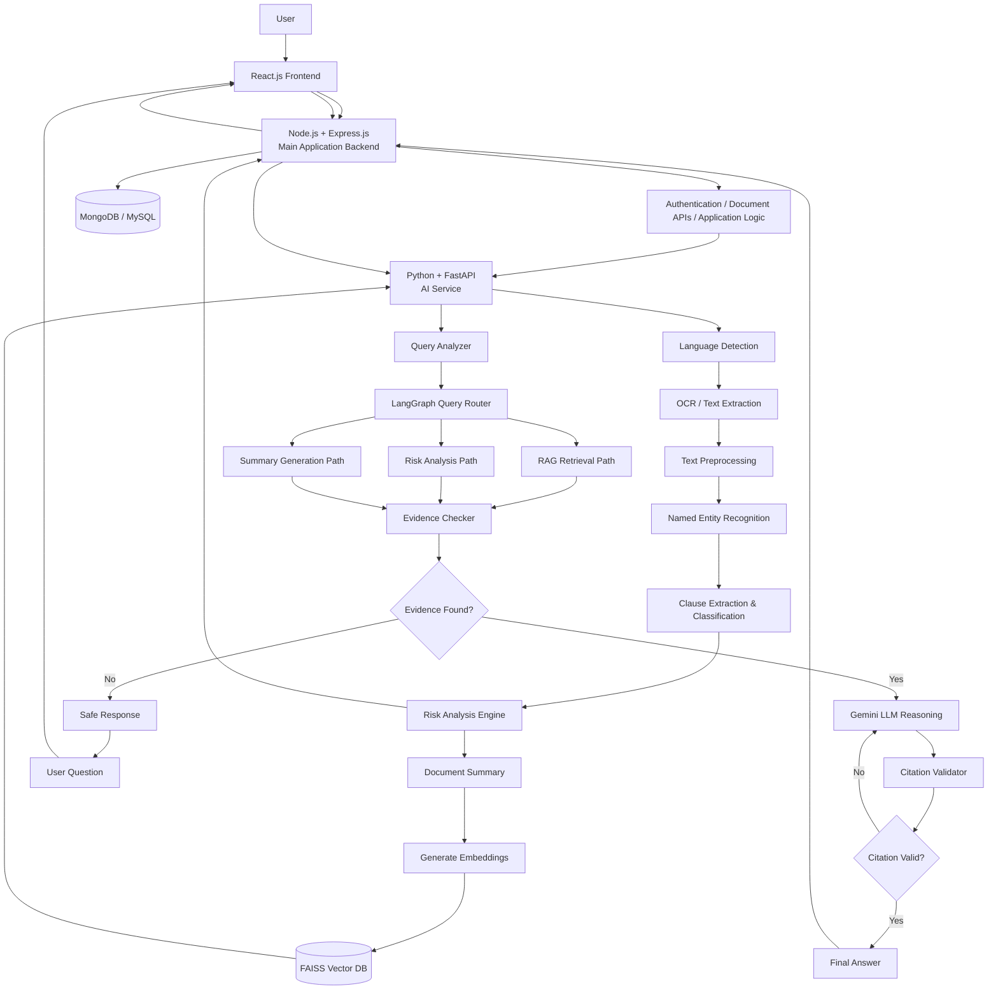
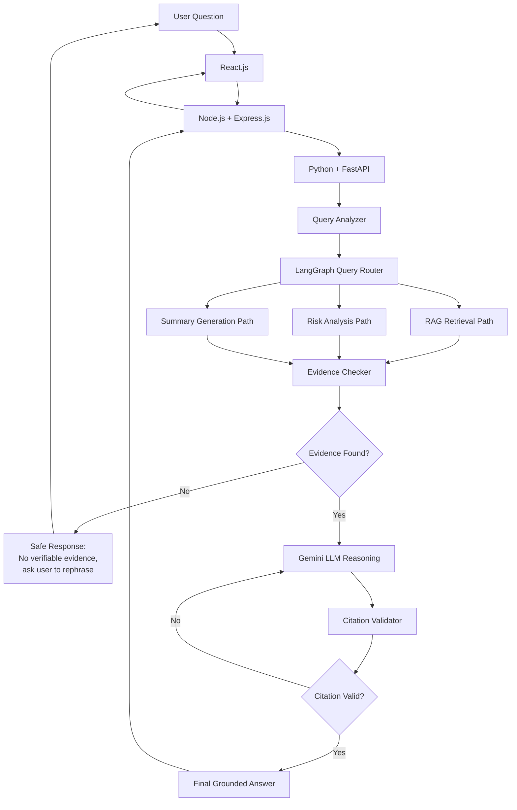

# ⚖️ LegalMind AI

> **Agentic Legal Document Intelligence & Risk Analysis Platform**

*"Turning Complex Legal Documents into Clear, Actionable Insights"*

---

## Overview

**LegalMind AI** is an AI-powered platform that enables users to upload legal documents and receive structured, evidence-grounded insights — including summaries, extracted clauses, risk analysis, and answers to natural-language questions about their documents.

The system is built around **user-uploaded legal documents** rather than a fixed dataset. It combines document processing (OCR/NLP), clause and entity extraction, a risk analysis engine, vector-based retrieval (RAG), and an agentic reasoning workflow powered by **LangGraph** and the **Gemini LLM** to produce answers that are grounded in the actual content of the uploaded document, with citations.

LegalMind AI is designed as an **AI-assisted document analysis tool**, not a legal advisory service. See the [Disclaimer](#disclaimer) section for details.

---

## Key Features

- 📄 Upload legal documents in PDF, DOCX, or TXT format
- 🌐 Multilingual document support (English, Hindi, Gujarati)
- 🔍 OCR and text extraction for both digital and scanned documents
- 🏷️ Named Entity Recognition (parties, dates, amounts, obligations)
- 📑 Legal clause extraction and classification
- ⚠️ Risk analysis engine with evidence-based, weighted risk scoring
- 📝 Automatic document summarization (key points, obligations, dates)
- 💬 Chat-based Q&A over uploaded documents (RAG-based)
- 🔗 Source, page, and section citations for every AI-generated answer
- 🧠 Agentic query routing via LangGraph (RAG / Risk / Summary paths)
- ✅ Evidence checking and citation validation before displaying answers
- 📊 Dashboard with risk visualization, clause highlights, and chat history
- 📥 Downloadable PDF reports
- 🔐 Role-based access control (Normal User / Admin)

---

## Problem Statement

Legal documents — contracts, agreements, notices, and policies — are often long, dense, and difficult for non-experts to interpret. Important obligations, deadlines, and risky clauses can be easily overlooked, and consulting a legal professional for every document is not always practical or immediate.

LegalMind AI addresses this by providing an AI-assisted first layer of understanding: summarizing documents, surfacing key entities and clauses, flagging potentially risky terms, and allowing users to ask direct questions and receive answers grounded in the document's actual content.

---

## Objectives

- Provide fast, structured understanding of uploaded legal documents
- Extract key entities, dates, obligations, and clauses automatically
- Identify and highlight potentially risky clauses using a structured risk analysis engine
- Enable natural-language, chat-based question answering over uploaded documents
- Ground all AI-generated answers in retrieved document evidence with citations
- Support multiple Indian languages (English, Hindi, Gujarati) with room for extension
- Maintain clear separation between AI-assisted analysis and professional legal advice

---

## User Roles

LegalMind AI defines **two user roles**, enforced through role-based access control.

### 👤 Normal User
- Register / Login
- Upload legal documents
- View their own uploaded documents
- Ask questions about their uploaded documents (chat interface)
- View document summaries
- View risk analysis and findings
- View citations for AI-generated answers
- View chat history
- Download analysis reports
- Manage (view/organize) their own documents

### 🛡️ Admin
- Manage users
- View uploaded documents (system-wide)
- Monitor system activity
- Manage document type definitions
- View analysis results across the system
- View risk findings across the system
- View logs / system information

---

## Supported Document Types

The system supports (and demonstrates analysis for) the following legal document categories. These are **supported/example categories** — LegalMind AI does not claim to understand every possible legal document type.

| Category | Examples |
|---|---|
| **Employment** | Employment Contract, Offer Letter, Appointment Letter |
| **Property** | Rental Agreement, Lease Agreement, Sale Agreement |
| **Business** | Partnership Agreement, Service Agreement, Vendor Agreement |
| **Confidentiality** | NDA / Non-Disclosure Agreement |
| **Financial** | Loan Agreement, Payment Agreement |
| **Legal** | Power of Attorney, Affidavit, Legal Notice |
| **Digital** | Privacy Policy, Terms & Conditions |
| **Corporate** | Shareholder Agreement, Consultancy Agreement |

**Supported file formats:** PDF, DOCX, TXT
The upload pipeline performs file validation, ownership checks, and document type selection/auto-detection. Invalid files are rejected and the user is prompted to re-upload.

---

## Supported Languages

LegalMind AI supports multilingual legal documents. Initial supported languages are:

- 🇬🇧 English
- 🇮🇳 Hindi
- 🇮🇳 Gujarati

The architecture is designed to be **extensible to additional languages** in the future, but unlimited/unsupported languages are **not** claimed.

**Language handling workflow:**

```
Document Uploaded
        ↓
Language Detection
        ↓
If English → Continue processing directly
If Hindi / Gujarati → Translate/process into internal processing language (if required)
        ↓
Continue legal analysis pipeline
        ↓
Generate response
        ↓
Return answer in the user's selected/original language where supported
```

Language detection occurs **before** the main NLP pipeline, ensuring all downstream processing (NER, clause extraction, risk analysis) operates on correctly prepared text.

---

## How It Works

LegalMind AI uses a **two-service backend architecture**:

- **Node.js + Express.js** act as the **main application backend**, handling authentication, application APIs, document management, and communication with the frontend.
- **Python + FastAPI** provide a dedicated **AI/document-processing service**, responsible for OCR, NLP, risk analysis, embeddings, RAG, LangGraph orchestration, and Gemini-based reasoning.

The **React.js** frontend never communicates with the AI service directly — all requests flow through the Node.js/Express application backend, which in turn calls the FastAPI AI service whenever document processing or AI reasoning is required.

At a high level:

1. A user authenticates (via Node.js/Express) and uploads a legal document (PDF/DOCX/TXT) through the React.js frontend.
2. Node.js/Express validates the request and forwards the document to the FastAPI AI service for processing.
3. FastAPI detects the language, extracts text (via OCR if scanned), cleans/chunks it, and runs NER and clause extraction/classification.
4. FastAPI's Risk Analysis Engine evaluates extracted clauses and produces a weighted risk assessment.
5. FastAPI generates a document summary, embeds text chunks, and stores them in a FAISS vector index. Results are returned to Node.js/Express, which persists them in MongoDB/MySQL.
6. When the user asks a question, Node.js/Express forwards the query to FastAPI, where LangGraph routes it to the appropriate path (RAG retrieval, risk analysis, or summary).
7. Retrieved evidence is checked before Gemini generates a grounded answer with citations, which is validated and returned to Node.js/Express.
8. Node.js/Express delivers the final answer to the React.js frontend, where it is displayed on the dashboard alongside risk insights and downloadable reports.

---

## Complete System Workflow

```
START
  ↓
1. USER ACCESS
  ↓
React.js Frontend
  ↓
Node.js + Express.js (Main Application Backend)
  ↓
Login / Register → Authentication → Role-Based Access
  ↓
Valid User?
  ├── NO  → Show Authentication Error → Retry
  └── YES
        ↓
2. UPLOAD LEGAL DOCUMENT (PDF / DOCX / TXT)
        ↓
React.js → Node.js + Express.js
        ↓
File Validation → Ownership Check → Document Type Selection / Auto-Detection
        ↓
Valid File Format?
  ├── NO  → Reject File → Ask User to Re-upload
  └── YES
        ↓
Node.js + Express.js
        ↓
Python + FastAPI (AI / Document Processing Service)
        ↓
──────────────────────────────────────────────
DOCUMENT PROCESSING PIPELINE (FastAPI AI Service)
──────────────────────────────────────────────
        ↓
3. LANGUAGE DETECTION
   → Detect document language (English / Hindi / Gujarati)
   → Translate/process internally if required
        ↓
4. OCR / TEXT EXTRACTION
   → Text PDF: PyMuPDF
   → Scanned PDF: EasyOCR
   → DOCX / TXT: Text Parsing
        ↓
5. TEXT CLEANING & PREPROCESSING
   → Remove noise, normalize text, handle formatting, chunking
        ↓
6. NAMED ENTITY RECOGNITION (NER)
   → Extract parties, dates, amounts, obligations, other legal entities
   → Technologies: spaCy, Legal-BERT
        ↓
7. CLAUSE EXTRACTION & CLASSIFICATION
   → Identify clauses → Classify type (Liability, Termination, Payment, etc.)
        ↓
8. RISK ANALYSIS ENGINE
   → Legal risk categories → Evidence-based scoring
   → Weighted risk calculation → Highlight risky clauses
        ↓
9. DOCUMENT SUMMARY
   → Key points, obligations, important dates, plain-language summary
        ↓
10. GENERATE EMBEDDINGS
    → Sentence Transformers convert chunks into vectors
        ↓
11. STORE IN FAISS VECTOR DATABASE
    → Document-specific index, chunk metadata (page, section, text), fast similarity search
        ↓
Results returned to Node.js + Express.js
        ↓
MongoDB / MySQL (Application Database)
   → Stores documents, metadata, analysis results, risk findings
        ↓
──────────────────────────────────────────────
LANGGRAPH AGENTIC WORKFLOW (RAG + LEGAL REASONING)
──────────────────────────────────────────────
        ↓
User asks a question (via chat interface)
        ↓
React.js
        ↓
Node.js + Express.js
        ↓
Python + FastAPI
        ↓
12. QUERY ANALYZER
    → Understand intent → Classify query type (Risk / Clause / Summary / Date / General)
        ↓
13. QUERY ROUTER (LangGraph)
    → Routes to: A. RAG Retrieval Path | B. Risk Analysis Path | C. Summary Generation Path
        ↓
14. EVIDENCE CHECKER
    → Verify relevant context → Check source/section → Determine if evidence is sufficient
        ↓
Evidence Found?
  ├── NO  → Generate Safe Response (no verifiable evidence, inform user, ask to rephrase)
  └── YES
       ↓
15. LEGAL REASONING (Gemini LLM)
    → Use retrieved evidence → Incorporate risk findings
    → Generate grounded answer with citations → Return in user's language where supported
       ↓
16. CITATION VALIDATOR
    → Validate source references → Ensure pages/sections exist → Check factual consistency
       ↓
Citation Valid?
  ├── NO  → Regenerate Answer or Safe Response
  └── YES
       ↓
Final Answer
       ↓
Python + FastAPI
       ↓
Node.js + Express.js
       ↓
React.js
       ↓
17. DISPLAY AI ANSWER
    → Show answer with citations → Highlight key clauses → Show risk insights
    → Support user's language → Allow report download
       ↓
18. DASHBOARD & REPORTS
    → Risk score visualization → Clause highlights → Important dates
    → Document summary → Chat history → Export PDF report
       ↓
END
```

---

## System Architecture

The core architectural principle of LegalMind AI is the separation between the **main application backend** and the **AI/document-processing service**:

```
React.js Frontend
        ↓
Node.js + Express.js (Main Application Backend)
        ↓
Python + FastAPI (AI / Document Processing Service)
        ↓
OCR / NLP / Risk Analysis / Embeddings
        ↓
FAISS
        ↓
LangGraph
        ↓
Gemini LLM
        ↓
Evidence + Citation Validation
        ↓
Node.js + Express.js
        ↓
React.js
        ↓
Final Answer / Dashboard / Reports
```



**Key points:**
- **FAISS** is connected to the **FastAPI AI service** for vector storage and retrieval.
- **MongoDB / MySQL** is connected to the **Node.js/Express application backend** for application-level data.
- The **React.js frontend never calls FastAPI directly** — all traffic is routed through Node.js/Express.

---

## Document Processing Pipeline

```mermaid
flowchart LR
    A[Upload via Node.js/Express] --> B[Language Detection]
    B --> C[OCR / Text Extraction]
    C --> D[Text Cleaning & Preprocessing]
    D --> E[Named Entity Recognition]
    E --> F[Clause Extraction & Classification]
    F --> G[Risk Analysis Engine]
    G --> H[Document Summary]
    H --> I[Generate Embeddings]
    I --> J[(FAISS Vector DB)]
    J --> K[Results Returned to Node.js/Express]
    K --> L[(MongoDB / MySQL)]
```



This entire pipeline runs within the **Python + FastAPI AI service**. Node.js/Express triggers this pipeline after a successful upload and persists the returned results.

---

## Vectorization & Storage

After document analysis, extracted text chunks are converted into vector embeddings and indexed for retrieval:

- **Embeddings:** Generated using **Sentence Transformers**, converting document chunks into dense vector representations, within the FastAPI AI service.
- **FAISS Vector Database:** Stores document-specific indexes along with chunk metadata (page, section, text) for fast similarity search during retrieval. FAISS is managed entirely by the **FastAPI AI service**.
- **Application Database (MongoDB / MySQL):** Stores application-level data — users, document metadata, analysis results, risk findings, chat history, and reports. This is managed by the **Node.js/Express backend**.

**FAISS** is used specifically for vector/similarity retrieval (semantic search over document content), while **MongoDB/MySQL** handles structured application data and relational metadata. MongoDB/MySQL does **not** store embeddings or vector indexes — that responsibility belongs entirely to FAISS.

---

## LangGraph Agentic Workflow

LegalMind AI uses **LangGraph**, orchestrated within the FastAPI AI service, to handle user queries rather than sending every question directly to an LLM.



**Flow summary:**
1. Node.js/Express receives the user's question from the React.js frontend and forwards it to FastAPI.
2. The **Query Analyzer** interprets user intent and classifies the query type (Risk, Clause, Summary, Date, General).
3. The **Query Router** (LangGraph) directs the query to the appropriate path: RAG Retrieval, Risk Analysis, or Summary Generation.
4. The **Evidence Checker** confirms whether sufficient, relevant document evidence exists before any answer is generated.
5. If evidence is insufficient, a **safe response** is returned instead of a fabricated answer.
6. If evidence is sufficient, **Gemini LLM** generates a grounded answer using retrieved context and risk findings, with citations.
7. The **Citation Validator** checks that referenced pages/sections actually exist and are consistent before the answer is returned to Node.js/Express and displayed in React.js.

---

## RAG Architecture

LegalMind AI uses **Retrieval-Augmented Generation (RAG)**, implemented within the FastAPI AI service, to ground its answers in the actual content of the uploaded document rather than relying purely on the LLM's internal knowledge.

```
Document → Text Extraction → Cleaning → Chunking → Embeddings → FAISS
                                                                    ↓
User Query → Node.js/Express → FastAPI → Query Analysis → LangGraph Routing → Retrieval
                                                                    ↓
                                                          Evidence Checking
                                                                    ↓
                                                              Gemini LLM
                                                                    ↓
                                                           Grounded Answer
                                                                    ↓
                                                        Citation Validation
```

**Why RAG is used:**
- To retrieve the most relevant portions of the specific uploaded document
- To ground generated answers in actual document content rather than general knowledge
- To reduce the likelihood of unsupported or fabricated answers
- To provide source, page, and section references alongside answers

> **Note:** RAG significantly reduces — but does not completely eliminate — the possibility of hallucinated or incorrect responses. Citation validation is an additional safeguard, not a guarantee of legal correctness.

---

## Risk Analysis

The **Risk Analysis Engine** is a core component of LegalMind AI's document intelligence pipeline, running within the FastAPI AI service.

It performs the following:
- Identifies legal risk categories relevant to the document
- Analyzes extracted and classified clauses
- Uses evidence directly from the document content
- Calculates a **weighted risk score** based on identified factors
- Highlights potentially risky clauses (e.g., unfavorable termination terms, liability exposure)
- Surfaces risk findings to the user via the dashboard and reports (delivered through Node.js/Express and rendered in React.js)

Risk scores and findings produced by LegalMind AI are **analytical indicators**, not definitive legal judgments. The system does not claim to provide "100% accurate legal advice" and does not replace a qualified legal professional.

> **Disclaimer:** LegalMind AI is an AI-assisted legal document analysis system and is not a substitute for professional legal advice. Users should consult a qualified legal professional for decisions requiring legal advice.

---

## Evidence & Citation Validation

LegalMind AI follows a strict **evidence-grounded reasoning flow** to avoid generating unsupported answers:

```
User Question
   → Query Analysis
   → Retrieval / Appropriate Agent
   → Evidence Checker
   → Evidence Found?
   → Gemini Reasoning
   → Citation Validation
   → Final Answer
```

**If sufficient evidence is not found:**
- The system does **not** fabricate an answer
- It clearly informs the user that sufficient evidence was not found in the document
- It asks the user to rephrase or ask a more specific question, where appropriate

**If citations are found to be invalid:**
- The answer is regenerated, or a safe response is returned instead

This evidence-checking and citation-validation loop is central to how LegalMind AI aims to keep answers grounded and traceable to actual document content, and it runs entirely within the FastAPI AI service before results are passed back to Node.js/Express.

---

## Technology Stack

### Frontend
- React.js

### Main Application Backend
- Node.js
- Express.js

### AI / Document Processing Service
- Python
- FastAPI

### OCR / Document Processing
- PyMuPDF
- EasyOCR
- DOCX / TXT parsing

### NLP / AI
- spaCy
- Legal-BERT
- Sentence Transformers
- Gemini LLM

### Vector Database
- FAISS

### Application Database
- MongoDB / MySQL
  *(Final database choice not yet locked — being finalized separately.)*

### Agentic AI
- LangGraph

### Architecture
- Retrieval-Augmented Generation (RAG)
- Agentic workflow orchestration
- Evidence checking
- Citation validation

> **Backend Note:** LegalMind AI does **not** use a single monolithic backend. Node.js + Express.js is the main application backend (auth, APIs, document management), while Python + FastAPI is a separate AI/document-processing service. FastAPI is not the main backend — it is a dedicated service called by Node.js/Express whenever AI processing is required.

### Backend Responsibilities

| Layer | Responsibilities |
|---|---|
| **Node.js + Express.js**<br/>(Main Application Backend) | User registration, login, authentication, role-based access control, user management, document upload API, document metadata management, document ownership checks, communication with the FastAPI AI service, chat API, retrieving analysis/risk/summary results, chat history, report management, admin functionality, application-level API handling |
| **Python + FastAPI**<br/>(AI / Document Processing Service) | Language detection, OCR, text extraction, text cleaning/preprocessing, chunking, NER, clause extraction & classification, risk analysis, document summarization, embedding generation, FAISS indexing, RAG retrieval, LangGraph agentic workflow, evidence checking, Gemini interaction, citation validation |

Node.js/Express does **not** perform NLP/OCR processing itself — it delegates all AI and document-processing work to the FastAPI service and manages the application-level data and APIs around it.

---

## Suggested Project Structure

> ⚠️ **Note:** This is a *suggested* structure for organizing the codebase. It does not represent a confirmed repository layout unless verified against actual project files.

```
LegalMind-AI/
│
├── frontend/
│   └── React.js application
│
├── backend/
│   └── node-server/
│       ├── src/
│       │   ├── controllers/
│       │   ├── routes/
│       │   ├── middleware/
│       │   ├── services/
│       │   ├── models/
│       │   ├── utils/
│       │   └── config/
│       └── package.json
│
├── ai-service/
│   ├── app/
│   │   ├── api/
│   │   ├── services/
│   │   ├── nlp/
│   │   ├── ocr/
│   │   ├── risk/
│   │   ├── rag/
│   │   ├── agents/
│   │   ├── models/
│   │   ├── schemas/
│   │   └── utils/
│   │
│   └── requirements.txt
│
├── storage/
├── faiss_indexes/
├── reports/
├── docs/
├── .env.example
├── README.md
└── .gitignore
```

---

## Database Architecture

**Conceptual entities and relationships:**

```
User
  └── owns many Documents

Document
  ├── has one DocumentMetadata
  ├── has one AnalysisResult
  ├── has many RiskFindings
  ├── has many ChatHistory entries
  └── has many Reports
```

| Entity | Description |
|---|---|
| **User** | Registered user account (Normal User or Admin) |
| **Document** | Uploaded legal document and its core metadata |
| **DocumentMetadata** | File details — type, language, format, upload info |
| **AnalysisResult** | NER output, extracted clauses, classification results, summary |
| **RiskFinding** | Risk categories, scores, and flagged clauses for a document |
| **ChatHistory** | User questions and AI-generated answers for a document |
| **Report** | Generated/exported report data for a document |

All of the above entities are managed through **MongoDB / MySQL**, accessed via the **Node.js/Express backend**. Document embeddings and vector indexes are **not** part of this database — they live in **FAISS**, managed by the FastAPI AI service.

> Exact schema design (fields, data types, relational constraints) is implementation-dependent and not defined here. The final choice between MongoDB and MySQL has not yet been locked.

---

## Installation

> Steps below use placeholders and example commands where actual configuration values are project-specific. LegalMind AI now runs as **three separate services**: the React.js frontend, the Node.js/Express backend, and the Python/FastAPI AI service.

1. **Clone the repository**
   ```bash
   git clone https://github.com/your-username/LegalMind-AI.git
   cd LegalMind-AI
   ```

2. **Set up environment variables**
   ```bash
   cp .env.example .env
   # Edit .env with your configuration values (see Environment Variables below)
   ```

3. **Set up MongoDB/MySQL**
   Set up a MongoDB and/or MySQL instance and update the connection string(s) in `.env`.

4. **Configure the Gemini API key**
   Add your Gemini API key to the AI service's `.env` as `GEMINI_API_KEY`.

5. **Start each service** (example conceptual startup — three terminals):

   **Terminal 1 — Frontend (React.js)**
   ```bash
   cd frontend
   npm install
   npm run dev
   ```

   **Terminal 2 — Main Application Backend (Node.js + Express.js)**
   ```bash
   cd backend/node-server
   npm install
   npm run dev
   ```

   **Terminal 3 — AI / Document Processing Service (Python + FastAPI)**
   ```bash
   cd ai-service
   python -m venv venv
   source venv/bin/activate   # On Windows: venv\Scripts\activate
   pip install -r requirements.txt
   uvicorn app.main:app --reload
   ```

> These are **example commands** reflecting the intended service layout. They should not be treated as confirmed/implemented unless verified against the actual repository.

---

## Environment Variables

Example environment variable structure, split by service:

```env
# Node.js / Express (Main Application Backend)
PORT=
DATABASE_URL=
MONGODB_URI=
AI_SERVICE_URL=

# FastAPI / AI Service
GEMINI_API_KEY=
FAISS_INDEX_PATH=
UPLOAD_DIR=
```

> Actual required environment variables depend on the final implementation and deployment setup. Never commit real API keys or credentials to the repository. The final choice of MongoDB vs. MySQL is still pending, so `DATABASE_URL` / `MONGODB_URI` are kept as generic placeholders for now.

---

## API Architecture

> ⚠️ The endpoints below are **suggested/example endpoints** based on the platform's workflow. They are not confirmed as implemented unless verified against the actual source code.

### Node.js / Express APIs
*(Main Application Backend — consumed by the React.js frontend)*

| Method | Endpoint | Description |
|---|---|---|
| POST | `/auth/register` | Register a new user |
| POST | `/auth/login` | Authenticate a user |
| POST | `/documents/upload` | Upload a legal document |
| GET | `/documents` | List documents owned by the user |
| GET | `/documents/{id}` | Get details of a specific document |
| POST | `/documents/{id}/chat` | Ask a question about a document |
| GET | `/documents/{id}/summary` | Retrieve document summary |
| GET | `/documents/{id}/risk-analysis` | Retrieve risk analysis results |
| GET | `/documents/{id}/report` | Download a generated report |

### FastAPI AI APIs
*(AI / Document Processing Service — called internally by Node.js/Express)*

| Method | Endpoint | Description |
|---|---|---|
| POST | `/process-document` | Run the full document processing pipeline |
| POST | `/detect-language` | Detect the language of a document |
| POST | `/extract-text` | Extract text via OCR/parsing |
| POST | `/analyze-document` | Run NER, clause extraction, and risk analysis |
| POST | `/generate-embeddings` | Generate and store document embeddings |
| POST | `/retrieve` | Retrieve relevant chunks from FAISS |
| POST | `/query` | Run the LangGraph agentic query workflow |
| POST | `/validate-citation` | Validate citations for a generated answer |

The FastAPI AI APIs are **internal service endpoints**, intended to be called by the Node.js/Express backend rather than directly by the frontend.

---

## Main Features

### Authentication & Authorization
- Login/Register
- Role-based access
- User/Admin separation

### Legal Document Upload
- PDF/DOCX/TXT
- File validation
- Ownership validation
- Document type selection/auto-detection

### Multilingual Processing
- English
- Hindi
- Gujarati
- Extensible language support

### Document Intelligence
- OCR
- Text extraction
- Text cleaning
- NER
- Clause extraction
- Clause classification

### Risk Analysis
- Risk categories
- Evidence-based scoring
- Weighted risk calculation
- Risky clause highlighting

### Document Understanding
- Summary
- Key points
- Important dates
- Obligations

### RAG & Agentic AI
- Query analysis
- LangGraph routing
- RAG retrieval
- Risk analysis path
- Summary path
- Evidence checking

### Grounded Legal Reasoning
- Gemini LLM
- Retrieved evidence
- Risk findings
- Citations
- Citation validation

### Reports
- Dashboard
- Risk visualization
- Clause highlights
- Summary
- PDF export
- Chat history

---

## Example User Journey

**Document upload and analysis:**

```
User
  ↓
React.js
  ↓
Node.js + Express.js
  ↓
Python + FastAPI (AI Service)
  ↓
Document Processing (OCR, NER, Clauses, Risk, Summary)
  ↓
FAISS (Embeddings & Indexing)
  ↓
Node.js + Express.js (stores results in MongoDB/MySQL)
  ↓
React.js Dashboard
```

1. User registers an account.
2. User logs in.
3. User uploads an **Employment Contract** (PDF) via the React.js frontend.
4. Node.js/Express validates the file and ownership, then forwards it to the FastAPI AI service.
5. FastAPI detects the document language.
6. OCR/text extraction is performed.
7. Text is cleaned and chunked.
8. NER extracts parties, dates, amounts, and obligations.
9. Clauses are extracted and classified.
10. The Risk Analysis Engine identifies potentially risky clauses.
11. A document summary is generated.
12. Embeddings are generated and stored in FAISS.
13. Results are returned to Node.js/Express and persisted in MongoDB/MySQL.

**Question answering:**

```
User
  ↓
React.js
  ↓
Node.js + Express.js
  ↓
Python + FastAPI
  ↓
LangGraph
  ↓
RAG / Risk / Summary Path
  ↓
Evidence Checker
  ↓
Gemini LLM
  ↓
Citation Validator
  ↓
Node.js + Express.js
  ↓
React.js
  ↓
Answer
```

14. User asks: *"What is the termination period?"*
15. Node.js/Express forwards the question to FastAPI.
16. The Query Analyzer identifies this as a clause/date-related question.
17. LangGraph routes the query to the appropriate path.
18. Relevant document chunks are retrieved from FAISS.
19. The Evidence Checker verifies sufficient evidence exists.
20. Gemini generates a grounded answer using the retrieved evidence.
21. The Citation Validator checks the page/section reference.
22. The answer flows back through FastAPI → Node.js/Express → React.js.
23. The user receives the answer along with its citation, views the risk dashboard, and exports a report.

---

## Multilingual Document Example

Example: a user uploads a document written in **Gujarati**.

```
Gujarati Document
   → React.js → Node.js + Express.js → Python + FastAPI
   → Language Detection
   → Gujarati Detected
   → Translation / Internal Processing (if required)
   → Legal NLP Pipeline (NER, Clause Extraction, Risk Analysis)
   → RAG Retrieval
   → Evidence Checking
   → Gemini Reasoning
   → Citation Validation
   → Response returned via Node.js + Express.js → React.js
   → Displayed in Gujarati
```

The exact translation and internal-processing strategy (e.g., translate-then-process vs. native multilingual processing) is implementation-dependent and may evolve as the system matures.

---

## Security Considerations

| Consideration | Status |
|---|---|
| Authentication (Node.js/Express) | Recommended |
| Password hashing | Recommended |
| Role-based authorization | Recommended |
| File ownership checks | Recommended |
| File type validation | Recommended |
| File size limits | Recommended |
| Secure upload handling | Recommended |
| Secure communication between Node.js/Express and FastAPI | Recommended |
| Environment variables for secrets | Recommended |
| Preventing unauthorized document access | Recommended |
| Validating user access before retrieving document chunks | Recommended |
| Avoiding exposure of sensitive document content | Recommended |
| API authentication (both services) | Recommended |
| Input validation | Recommended |

> These are recommended security practices for the described architecture. Actual implementation status should be verified against the codebase — do not assume a practice is implemented unless confirmed.

---

## Privacy Considerations

Legal documents frequently contain sensitive personal and business information. The system is designed with the following privacy principles in mind:

- Documents should be restricted to their respective owners
- Access control should be applied consistently across all document operations
- One user's documents should never be exposed to another user
- Stored files and metadata should be protected from unauthorized access
- Sensitive document contents should not be logged unnecessarily, including in inter-service communication between Node.js/Express and FastAPI

> No specific encryption standards or compliance certifications (e.g., GDPR, SOC 2) are claimed unless explicitly implemented and verified.

---

## Limitations

- AI-generated analysis may contain errors or inaccuracies.
- Legal interpretation can depend heavily on jurisdiction and context not captured by the system.
- OCR quality depends on the quality and clarity of the scanned document.
- Scanned or handwritten documents may be harder to process accurately.
- Translation (for Hindi/Gujarati documents) may affect legal meaning or nuance.
- Risk scores are analytical indicators, not definitive legal judgments.
- The system does not replace a qualified lawyer.
- Unsupported or unusual document types may produce lower-quality results.
- Citation validation improves grounding but does not guarantee legal correctness.
- The two-service architecture (Node.js/Express + FastAPI) introduces additional inter-service communication that must be reliable for the system to function end-to-end.

---

## Future Enhancements

- Support for additional languages
- Support for additional document types
- Improved multilingual legal language models
- Enhanced OCR accuracy
- More advanced clause classification models
- More sophisticated risk scoring models
- Hybrid search (keyword + semantic retrieval)
- Improved retrieval reranking
- Cloud deployment options
- Additional document storage options
- Advanced access control mechanisms
- Document comparison features
- Version tracking for documents
- Collaboration features for teams
- Lawyer review / hand-off workflow
- Finalizing the application database choice (MongoDB vs. MySQL)

> These are planned/future directions and are **not** part of the currently defined architecture.

---

## Demo Documents

For demonstration and development purposes, publicly available legal document templates and model agreements can be obtained from official/government sources and other appropriately licensed sources.

Examples include:
- Startup India templates
- Government of India model property documents
- Other appropriately licensed legal document sources

> These demonstration documents are used for showcasing the platform's document analysis capabilities. They are not described as a "training dataset," and no claim is made that the AI models are trained on them unless explicitly implemented.

---

## Disclaimer

**LegalMind AI is an AI-assisted legal document analysis system and is not a substitute for professional legal advice. Users should consult a qualified legal professional for decisions requiring legal advice.**

LegalMind AI is intended for AI-assisted legal document analysis, information retrieval, summarization, and risk insight generation. It does not provide legal advice and does not replace a qualified legal professional. Users should consult a lawyer for legal decisions or interpretation requiring professional advice.

---

## License

*To be decided.*

---

### Currently Defined Architecture vs. Suggested Implementation Details

To keep this README accurate:

- **Currently Defined Architecture** — The two-service backend split (Node.js/Express + Python/FastAPI), the System Workflow, Document Processing Pipeline, LangGraph Agentic Workflow, RAG Architecture, Risk Analysis, and Evidence/Citation Validation reflect the finalized design of LegalMind AI.
- **Suggested Implementation Details** — Sections such as Project Structure, API Architecture, Installation commands, and Environment Variables are labeled as *suggested/example* and should be verified against the actual codebase before being treated as fact.
- **Future Enhancements** — Explicitly not part of the current architecture; listed as potential future directions only, including the still-pending MongoDB vs. MySQL decision.
